# Thiết kế Gold hoàn chỉnh và yêu cầu xử lý Silver từ Bronze

> Phiên bản chốt lại theo nguyên tắc: Gold là mô hình phân tích đích; Silver chỉ xử lý dữ liệu Bronze để tạo đầu vào đúng grain, mã, đơn vị, phạm vi và chất lượng mà Gold yêu cầu. Thiếu sót của dữ liệu nguồn không phải lý do loại bỏ thuộc tính cần thiết khỏi Gold.

## Phạm vi và kết luận điều hành

Tài liệu này đánh giá mô hình hiện tại dựa trên ba nhóm bằng chứng: ERD 8 Fact + 8 Dimension trong bản Word, đề cương đề tài, và dữ liệu thực trong thư mục Drive. Kết luận chính:

- Hướng tách 8 Fact theo business process là hợp lý và có thể giữ lại.
- Mô hình chưa an toàn để triển khai ngay vì chưa khóa đầy đủ grain, phạm vi địa lý, phiên bản nguồn, trạng thái số liệu và quy tắc chọn nguồn chuẩn.
- `dim_source` không nên là một dimension nghiệp vụ trong 8 dimension cốt lõi. Tuy nhiên, không được loại bỏ metadata nguồn. Cần quản lý bằng `silver_meta.dataset_registry`, `silver_meta.observation_set` và các cột lineage kỹ thuật trong Fact.
- `observation_set_id` chỉ ngăn trùng về mặt kỹ thuật; nó không tự ngăn BI cộng nhiều nguồn hoặc nhiều phiên bản của cùng một quan sát. Gold phải có một lớp `*_current` hoặc `*_canonical` chỉ công bố một bản ghi được chọn cho mỗi grain nghiệp vụ.
- Thiết kế đích giữ 8 Fact và 8 Dimension cốt lõi, nhưng bổ sung bridge/mapping, audit, quarantine và aggregate mart ngoài con số 8 + 8. Đây không phải là Dimension nghiệp vụ bổ sung.

### Bằng chứng nổi bật từ dữ liệu

| Nguồn | Phạm vi quan sát được | Phát hiện quyết định thiết kế |
|---|---:|---|
| FAOSTAT Production | 28.409 dòng; 1961-2024 | Long-format theo `Element`; 1.303 giá trị thiếu; cờ chất lượng khác nhau theo Area, Production, Yield nên khi pivot phải giữ cờ riêng cho từng measure. |
| FAOSTAT Producer Price | 11.527 dòng | Annual có LCU, SLC, USD và Index; monthly chỉ có LCU. `Unit` của index để trống, nên ý nghĩa phải lấy từ `Element`/series metadata. |
| FAOSTAT Trade Matrix | 5.920 dòng; Việt Nam × đối tác × 2012-2023 | Có 4 Element: export/import quantity/value. Grain hợp lệ nhưng không được cộng cùng UN Comtrade như cùng một nguồn. |
| FAOSTAT TCL | 44.345 dòng; 1961-2024 | Là tổng theo quốc gia, chỉ có export quantity/value trong tệp hiện có; không được join trực tiếp với partner Fact rồi cộng measure. |
| UN Comtrade | 2.807 annual + 7.824 monthly | HS classification đổi H3→H6; monthly đều `isAggregate=true`, `isReported=false`; nhãn reporter/partner trống; cần mapping mã và chính sách chọn quantity/value rõ ràng. |
| Dữ liệu tỉnh 3 cây | 2.473 dòng | 2.142 dòng cấp huyện, 331 dòng cấp tỉnh; `source_scope` gồm district total, province total, smallholder only, partial-to-July. Nếu bỏ trường `district`, 2.328 dòng rơi vào khóa trùng giả tạo. |
| NASA POWER | 614.754 dòng, 63 điểm, 2000-2026 | Không trùng khóa điểm-ngày, nhưng có sentinel `-999`: 126 dòng cho đa số biến và 5.040 dòng cho solar radiation. Phải đổi thành NULL ở Silver. |
| Giá cà phê địa phương | 240 dòng | Có 24 dòng trùng khóa `(year, month)` trong 2022, nhiều cặp chênh đúng 1 VND/kg; cần quarantine và quy tắc thắng bản ghi. |
| Coffee stock | 450 dòng | Trộn actual và `Dự báo 2025/2026`; đơn vị nghìn bao 60 kg phải chuẩn hóa thành tấn và giữ scenario/status. |
| WDI | 396 dòng, 6 indicator, Việt Nam 1960-2025 | 138 giá trị NULL; toàn bộ cột `unit` trống. Unit và aggregation rule phải quản lý trong indicator metadata. |
| Pink Sheet | 1.963 dòng wide/raw | Trộn Monthly Prices, Monthly Indices, Description, Index Weights và Mismatch Details; không được nạp nguyên bảng vào Fact Price. |

## Output 1 Thiết kế Gold và mã Mermaid đầy đủ

### Quy ước bắt buộc

- Mọi Fact dùng surrogate PK để thuận tiện kỹ thuật, nhưng uniqueness được kiểm tra bằng natural grain ghi dưới từng sơ đồ.
- Các khóa dimension không được NULL. Dùng member `0 = UNKNOWN` và `-1 = NOT_APPLICABLE` khi thích hợp.
- `observation_set_id`, `record_source_code`, `ingested_at` là lineage kỹ thuật, không phải dimension để người dùng tùy ý group/sum.
- Chỉ các view `gold_semantic.*_canonical` được cấp cho dashboard mặc định. Bảng base có thể giữ nhiều nguồn để đối soát.
- `period_type` được kiểm tra theo Fact: YEAR, MONTH, DAY hoặc CROP_YEAR. Không cho phép một Fact trộn sai loại kỳ.
- Iceberg không thực thi PK/FK như RDBMS; các ràng buộc dưới đây phải được thực thi bằng dbt tests và kiểm tra Spark.

### Composite keys và cách biểu diễn trong Mermaid

Mermaid ER chỉ được dùng để mô tả cột và quan hệ. Không gắn `UK` riêng cho từng cột thuộc khóa tổ hợp, vì điều đó có thể bị hiểu là từng cột unique độc lập. Composite uniqueness được chốt tại DDL logic và dbt tests như sau:

| Bảng | Composite unique key |
|---|---|
| `DIM_PERIOD` | `(period_type, period_code)` |
| `DIM_GEOGRAPHY` | `(geography_code, geography_version)` |
| `DIM_WEATHER_LOCATION` | `(weather_location_code, valid_from)` |
| `DIM_PRICE_SERIES` | `(series_code, valid_from)` |
| `DIM_TRADE_PRODUCT` | `(classification_system, classification_version, product_code)` |
| `BRIDGE_TRADE_PRODUCT_COMMODITY` | `(trade_product_key, commodity_key, valid_from)` |
| `FACT_PRODUCTION_NATIONAL` | `(period_key, country_key, commodity_key, observation_set_id)` |
| `FACT_PRODUCTION_PROVINCIAL` | `(period_key, geography_key, commodity_key, coverage_code, record_status_code, observation_set_id)` |
| `FACT_PRICE` | `(period_key, commodity_key, country_key, geography_key, price_series_key, observation_set_id)` |
| `FACT_TRADE_TOTAL` | `(period_key, reporter_country_key, trade_product_key, trade_flow_code, observation_set_id)` |
| `FACT_TRADE_PARTNER` | `(period_key, reporter_country_key, partner_country_key, trade_product_key, trade_flow_code, observation_set_id)` |
| `FACT_WEATHER_DAILY` | `(period_key, weather_location_key, observation_set_id)` |
| `FACT_COFFEE_STOCK` | `(period_key, country_key, commodity_key, scenario_code, observation_set_id)` |
| `FACT_MACRO_INDICATOR` | `(period_key, country_key, macro_indicator_key, observation_set_id)` |

Mẫu dbt test:

```yaml
models:
  - name: dim_period
    tests:
      - dbt_utils.unique_combination_of_columns:
          combination_of_columns: [period_type, period_code]
  - name: dim_trade_product
    tests:
      - dbt_utils.unique_combination_of_columns:
          combination_of_columns:
            - classification_system
            - classification_version
            - product_code
```

Mẫu DDL tham chiếu cho engine có hỗ trợ unique constraint:

```sql
alter table dim_period
  add constraint uq_dim_period unique (period_type, period_code);

alter table dim_geography
  add constraint uq_dim_geography unique (geography_code, geography_version);

alter table dim_trade_product
  add constraint uq_dim_trade_product
  unique (classification_system, classification_version, product_code);
```

Các Fact áp dụng cùng nguyên tắc với đúng tổ hợp trong bảng trên. Nếu engine như Iceberg không enforce `UNIQUE`, DDL chỉ là khai báo logic; dbt/Spark test là cổng thực thi bắt buộc trước publish.

Với Iceberg, PK/FK và unique key là logical constraints; pipeline phải dừng publish khi test uniqueness hoặc referential integrity thất bại.

### Danh mục 8 Dimension cốt lõi

| Dimension | Grain | Business key | SCD | Vai trò |
|---|---|---|---|---|
| `dim_period` | Một kỳ chuẩn hóa | `(period_type, period_code)` | Type 0 | Ngày, tháng, năm, niên vụ. |
| `dim_commodity` | Một nhóm hàng/cây phân tích | `commodity_code` | Type 1 | Cà phê, cao su, hồ tiêu và mapping FAOSTAT cấp commodity. |
| `dim_country` | Một quốc gia/vùng tổng hợp M49 | `m49_code` | Type 1 | Country dùng chung; role-playing reporter/partner. |
| `dim_geography` | Một đơn vị hành chính tại một phiên bản | `(geography_code, geography_version)` | Type 2 | Tỉnh/huyện; giữ parent và hiệu lực. |
| `dim_weather_location` | Một điểm/grid thời tiết có hiệu lực | `weather_location_code` | Type 2 | Tọa độ NASA POWER và mapping địa lý. |
| `dim_price_series` | Một chuỗi giá có cùng định nghĩa | `series_code` | Type 2 | Price/index, currency, unit, market scope, frequency, base. |
| `dim_trade_product` | Một mã sản phẩm trong một phiên bản phân loại | `(classification_system, classification_version, product_code)` | Type 1 | FAOSTAT item/HS, level, leaf; mapping commodity được tách sang bridge. |
| `dim_macro_indicator` | Một chỉ tiêu vĩ mô | `indicator_code` | Type 1 | Unit, scale và aggregation rule của WDI. |

### Data dictionary Gold đã chốt

Các bảng dưới đây là schema đích. Silver phải tạo đủ dữ liệu phù hợp; cột NULL chỉ biểu thị measure có thể thiếu hợp lệ, không phải được phép bỏ khỏi thiết kế.

#### Dimension

| Bảng | Business key | Thuộc tính hoàn chỉnh | SCD |
|---|---|---|---|
| `DIM_PERIOD` | `period_type + period_code` | `period_key`, `period_type`, `period_code`, `period_start_date`, `period_end_date`, `calendar_year`, `calendar_quarter`, `calendar_month`, `calendar_day`, `day_of_year`, `crop_year_label`, `days_in_period`, `period_label`, `period_sort_key`, `is_complete_period` | Type 0 |
| `DIM_COMMODITY` | `commodity_code` | `commodity_key`, `commodity_code`, `commodity_name`, `commodity_name_vi`, `commodity_group`, `faostat_item_code`, `faostat_item_name`, `canonical_mass_unit`, `is_active` | Type 1 |
| `DIM_COUNTRY` | `m49_code` | `country_key`, `m49_code`, `iso2_code`, `iso3_code`, `country_name`, `country_name_vi`, `country_type`, `region_name`, `income_group`, `currency_code`, `is_aggregate`, `is_active` | Type 1 |
| `DIM_GEOGRAPHY` | `geography_code + geography_version` | `geography_key`, `geography_code`, `geography_version`, `geography_name`, `geography_name_normalized`, `geography_level`, `parent_geography_code`, `country_key`, `province_code`, `province_name`, `district_code`, `district_name`, `valid_from`, `valid_to`, `is_current` | Type 2 |
| `DIM_WEATHER_LOCATION` | `weather_location_code + valid_from` | `weather_location_key`, `weather_location_code`, `weather_provider`, `grid_method`, `latitude`, `longitude`, `elevation_m`, `geography_key`, `valid_from`, `valid_to`, `is_current` | Type 2 |
| `DIM_PRICE_SERIES` | `series_code + valid_from` | `price_series_key`, `series_code`, `series_name`, `price_type`, `source_dataset_code`, `market_scope`, `commodity_variant`, `native_currency_code`, `native_unit_code`, `canonical_unit_code`, `index_base_label`, `frequency_code`, `valuation_basis`, `valid_from`, `valid_to`, `is_current` | Type 2 |
| `DIM_TRADE_PRODUCT` | `classification_system + classification_version + product_code` | `trade_product_key`, `classification_system`, `classification_version`, `product_code`, `product_name`, `aggregation_level`, `is_leaf`, `is_active` | Type 1 |
| `DIM_MACRO_INDICATOR` | `indicator_code` | `macro_indicator_key`, `indicator_code`, `indicator_name`, `indicator_group`, `unit_code`, `scale_factor`, `aggregation_rule`, `value_type`, `description`, `is_active` | Type 1 |

#### Fact

| Bảng | Grain nghiệp vụ | Foreign key | Measure và thuộc tính bắt buộc |
|---|---|---|---|
| `FACT_PRODUCTION_NATIONAL` | Country × Commodity × Year × Observation Set | `period_key`, `country_key`, `commodity_key` | `area_harvested_ha`, `production_tonnes`, `yield_kg_ha`, `yield_calculation_method`, ba quality flag, lineage, `is_canonical`, `loaded_at` |
| `FACT_PRODUCTION_PROVINCIAL` | Geography × Commodity × Year × Coverage × Status × Observation Set | `period_key`, `geography_key`, `commodity_key` | `area_planted_ha`, `area_harvested_ha`, `production_tonnes`, `yield_kg_ha`, `yield_calculation_method`, `coverage_code`, `record_status_code`, quality flags, lineage, `is_canonical`, `loaded_at` |
| `FACT_PRICE` | Price Series × Commodity × Geographic Scope × Period × Observation Set | `period_key`, `commodity_key`, `country_key`, `geography_key`, `price_series_key` | `price_amount_native`, `price_amount_canonical`, `price_index_value`, flag, lineage, `is_canonical`, `loaded_at` |
| `FACT_TRADE_TOTAL` | Reporter × Trade Product × Flow × Period × Observation Set | `period_key`, `reporter_country_key`, `commodity_key`, `trade_product_key` | `trade_quantity_tonnes`, `trade_value_usd`, flags, lineage, `is_canonical`, `loaded_at` |
| `FACT_TRADE_PARTNER` | Reporter × Partner × Trade Product × Flow × Period × Observation Set | `period_key`, `reporter_country_key`, `partner_country_key`, `commodity_key`, `trade_product_key` | `trade_quantity_tonnes`, `trade_value_usd`, estimated flags, lineage, `is_canonical`, `loaded_at` |
| `FACT_WEATHER_DAILY` | Weather Location × Day × Observation Set | `period_key`, `weather_location_key` | temperature avg/max/min, humidity, wind, precipitation, solar radiation, coverage fields, lineage, `is_canonical`, `loaded_at` |
| `FACT_COFFEE_STOCK` | Country × Coffee × Crop Year × Scenario × Observation Set | `period_key`, `country_key`, `commodity_key` | `ending_stock_thousand_bags`, `bag_weight_kg`, `ending_stock_tonnes`, `scenario_code`, lineage, `is_canonical`, `loaded_at` |
| `FACT_MACRO_INDICATOR` | Country × Year × Indicator × Observation Set | `period_key`, `country_key`, `macro_indicator_key` | `indicator_value`, `observation_status_code`, lineage, `is_canonical`, `loaded_at` |

Các cột lineage chuẩn áp dụng cho mọi Fact gồm `observation_set_id`, `record_source_code`, `is_canonical` và `loaded_at`. Chúng không tạo thêm `DIM_SOURCE`; metadata chi tiết vẫn được giữ tại Silver/audit.

### D00 Toàn bộ 8 Dimension

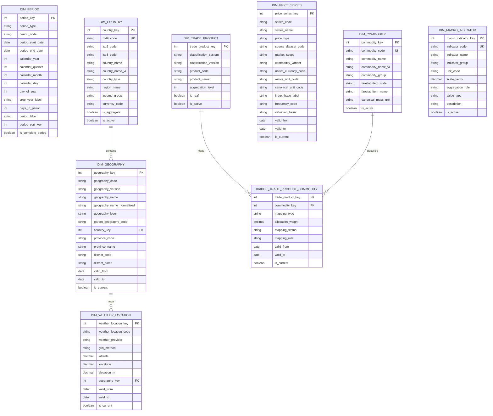

`BRIDGE_TRADE_PRODUCT_COMMODITY` là bảng hỗ trợ mapping, không tính là Fact hoặc Dimension cốt lõi thứ chín. Silver duy trì mapping và Gold có thể công bố bridge để truy vấn có kiểm soát.

Quy tắc mapping:

- Mapping 1:1, `mapping_status='APPROVED'`: được phép điền `commodity_key` tương ứng vào Fact.
- Mapping nhiều-nhiều có allocation weight được nghiệp vụ phê duyệt: chỉ phân bổ trong mart chuyên biệt; tổng weight theo product và khoảng hiệu lực phải bằng 1.
- Mapping nhiều-nhiều không có trọng số đáng tin cậy: Fact dùng member `UNKNOWN/UNALLOCATED`; không nhân bản quantity/value sang từng commodity.
- `allocation_weight` NULL nghĩa là quan hệ phân loại/tham chiếu, không phải quyền phân bổ measure.
- Mapping phải version hóa theo classification version và khoảng hiệu lực; không dùng mapping của H6 cho H3 nếu chưa được phê duyệt.

### Quy tắc SCD Type 2

Áp dụng cho `DIM_GEOGRAPHY`, `DIM_WEATHER_LOCATION` và `DIM_PRICE_SERIES`.

1. Khoảng hiệu lực dùng quy ước nửa mở `[valid_from, valid_to)`. Dòng current có `valid_to=NULL` và `is_current=true`.
2. Trên cùng business key, các khoảng hiệu lực không được chồng lấn và chỉ có tối đa một dòng current.
3. Khi thuộc tính tracked thay đổi, đóng phiên bản cũ bằng `old.valid_to = new.valid_from`, sau đó tạo surrogate key mới.
4. Thay đổi chỉ do sửa lỗi chính tả ở thuộc tính không tracked có thể Type 1; thay đổi địa giới, tọa độ/mapping điểm, market scope, currency, unit, frequency hoặc index base bắt buộc Type 2.
5. Fact lookup surrogate key bằng thời điểm quan sát, không dùng thời điểm ingest:

```sql
observation_date >= valid_from
AND observation_date < COALESCE(valid_to, DATE '9999-12-31')
```

6. Với period MONTH/YEAR/CROP_YEAR, lookup dùng `period_start_date` trừ khi business rule của dimension quy định hiệu lực theo cuối kỳ; quy tắc phải nhất quán cho toàn bộ Fact.
7. Nếu không tìm thấy đúng một phiên bản dimension, bản ghi Fact không được tự động lấy dòng current. Phải quarantine hoặc map vào `UNKNOWN` kèm error code.
8. Late-arriving dimension: tạo/điều chỉnh version trước, sau đó re-key các Fact chịu ảnh hưởng bằng MERGE có kiểm soát.

Các test bắt buộc cho từng SCD2 dimension:

| Test | Điều kiện pass |
|---|---|
| Business-version uniqueness | Composite key của dimension không trùng |
| One current | Mỗi business key có không quá một `is_current=true` |
| Current consistency | `is_current=true` khi và chỉ khi `valid_to IS NULL` |
| Valid interval | `valid_to > valid_from` khi `valid_to` khác NULL |
| No overlap | Không tồn tại hai dòng cùng business key có khoảng hiệu lực giao nhau |
| Fact point-in-time lookup | Mỗi Fact khớp đúng một surrogate key tại observation date |

Mẫu kiểm tra overlap:

```sql
select a.business_key
from dimension_scd2 a
join dimension_scd2 b
  on a.business_key = b.business_key
 and a.surrogate_key < b.surrogate_key
 and a.valid_from < coalesce(b.valid_to, date '9999-12-31')
 and b.valid_from < coalesce(a.valid_to, date '9999-12-31')
```

### F01 Production National

Grain: một Country × Commodity × Calendar Year × Observation Set. View canonical chỉ còn một dòng cho Country × Commodity × Year.

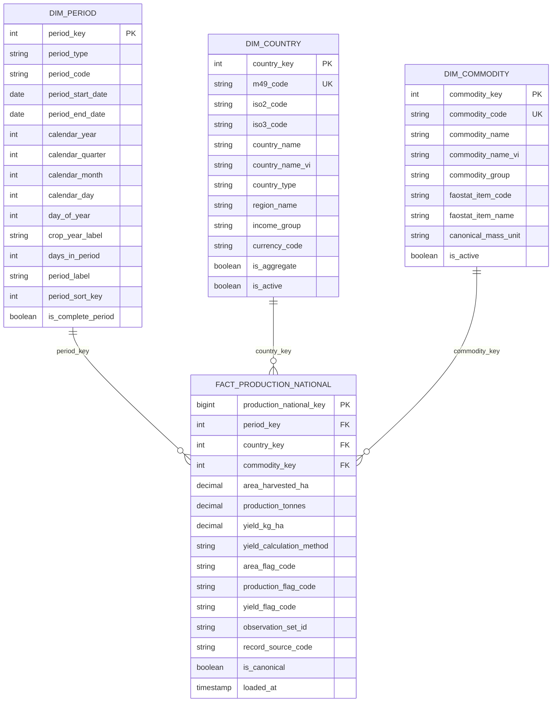

Ràng buộc: `period_type='YEAR'`; unique base `(period_key,country_key,commodity_key,observation_set_id)`; `yield_calculation_method` nhận `REPORTED|DERIVED|UNAVAILABLE`; không SUM `yield_kg_ha`; yield tổng hợp = `SUM(production_tonnes)*1000/SUM(area_harvested_ha)`.

### F02 Production Provincial

Giữ đúng business process cấp địa phương của thiết kế ban đầu, nhưng `DIM_GEOGRAPHY` hỗ trợ cả tỉnh và huyện. Grain: một Geography member cụ thể × Commodity × Year × Coverage × Status × Observation Set. Gold bắt buộc có `yield_kg_ha`; Silver chịu trách nhiệm chuẩn hóa và tính hợp lệ từ dữ liệu Bronze.

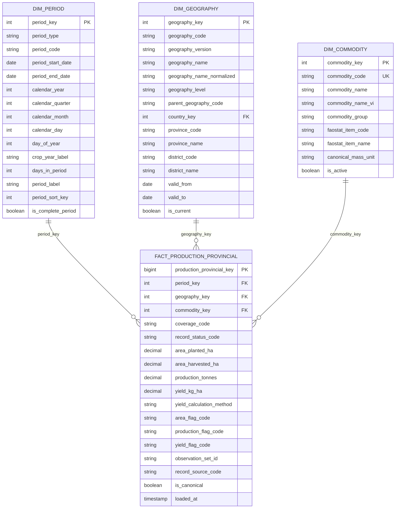

Ràng buộc: `period_type='YEAR'`; `coverage_code` thuộc `ALL_PRODUCERS|SMALLHOLDER_ONLY|PARTIAL_TO_DATE`; không cộng dòng `province` cùng các dòng `district` con; không thay `area_planted` bằng `area_harvested`. `yield_kg_ha` luôn có trong thiết kế Gold: ưu tiên giá trị nguồn công bố; nếu nguồn không có thì Silver tính `production_tonnes*1000/area_harvested_ha` khi hai thành phần cùng grain/coverage/status/source. `yield_calculation_method` nhận `REPORTED|DERIVED|UNAVAILABLE`.

### F03 Price

Grain: một Price Series × Commodity × geographic scope × Period × Observation Set.

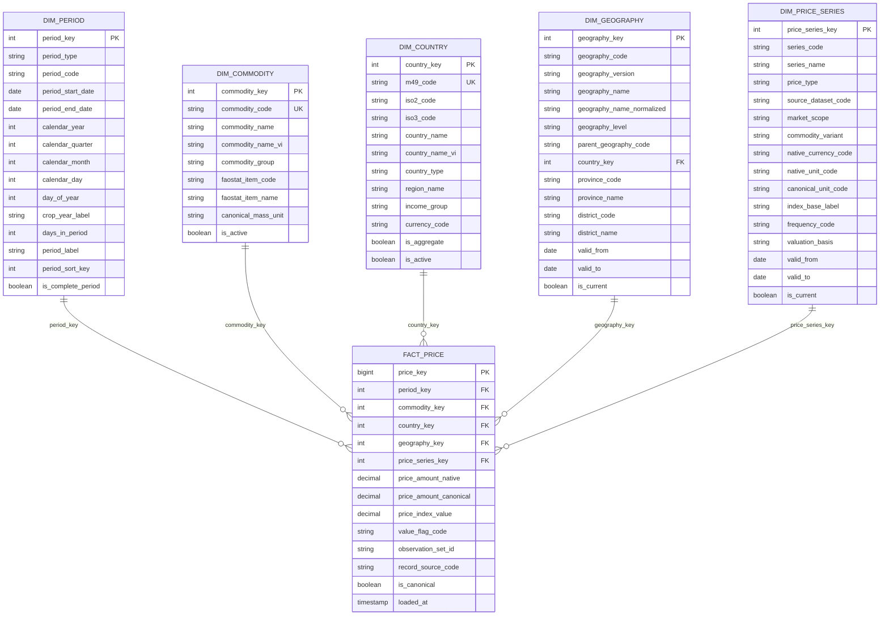

Ràng buộc: đúng một geographic scope có nghĩa; member N/A thay NULL; đúng một trong `price_amount_native` và `price_index_value` có giá trị; canonical amount chỉ ghi khi conversion chính xác và có tỷ giá đúng kỳ; LCU giữa các nước không được so sánh trực tiếp.

Constraint địa lý theo `DIM_PRICE_SERIES.market_scope`:

| `market_scope` | `country_key` hợp lệ | `geography_key` hợp lệ | Kiểm tra bổ sung |
|---|---|---|---|
| `GLOBAL` | Member `WORLD` | Member `NOT_APPLICABLE` | Không được gắn một quốc gia cụ thể |
| `COUNTRY` | Một country member, `is_aggregate=false` | `NOT_APPLICABLE` | Country phải đúng country được định nghĩa bởi series |
| `PROVINCE` | Country chứa tỉnh | Geography có `geography_level='PROVINCE'` | `fact.country_key = dim_geography.country_key` |
| `DISTRICT` | Country chứa huyện | Geography có `geography_level='DISTRICT'` | Country khớp geography và district thuộc đúng parent province |

Quy ước thống nhất: giá thế giới luôn dùng `country_key=WORLD`, không dùng `NOT_APPLICABLE` cho country. `NOT_APPLICABLE` chỉ được dùng cho geography khi scope không có địa lý dưới quốc gia.

Các kiểm thử bắt buộc:

- Không cho phép `market_scope='COUNTRY'` đồng thời có geography thực.
- Không cho phép scope địa phương nhưng `geography_key=NOT_APPLICABLE`.
- Không cho phép geography thuộc quốc gia khác với `country_key` trên Fact.
- Không cho phép một `series_code` thay đổi market scope mà không sinh phiên bản SCD2 mới.
- Kiểm tra constraint bằng dbt expression test hoặc model test join `FACT_PRICE` với `DIM_PRICE_SERIES` và `DIM_GEOGRAPHY`.

### F04 Trade Total

Grain: Reporter Country × Trade Product × Flow × Period × Observation Set. Dùng cho tổng thương mại theo quốc gia, không có partner.

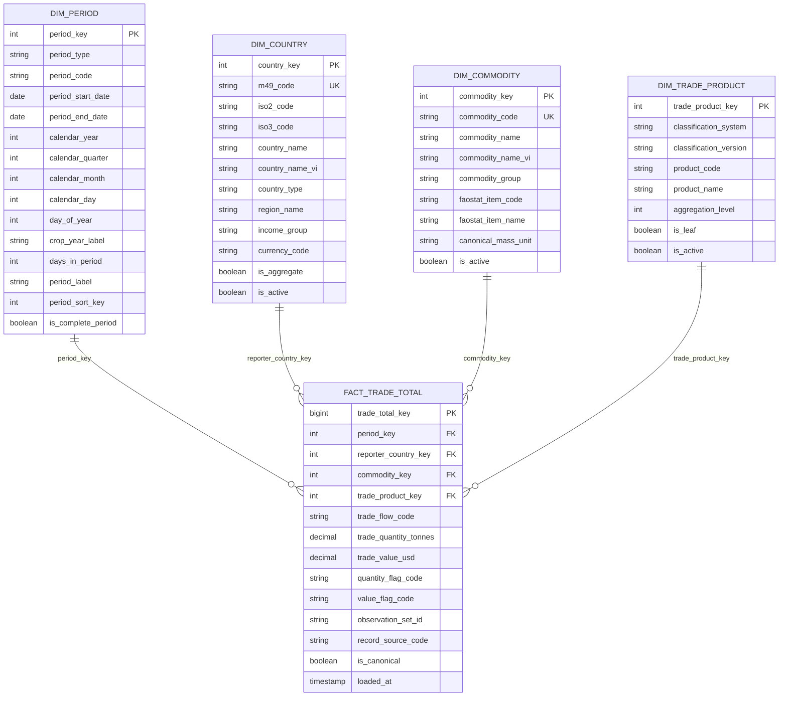

Ràng buộc: unique `(period_key,reporter_country_key,trade_product_key,trade_flow_code,observation_set_id)`; không cộng annual với 12 monthly của cùng năm; unit value = `SUM(value)/SUM(quantity)`, không AVG tỷ lệ dòng.

### F05 Trade Partner

Grain: Reporter Country × Partner Country × Trade Product × Flow × Period × Observation Set.

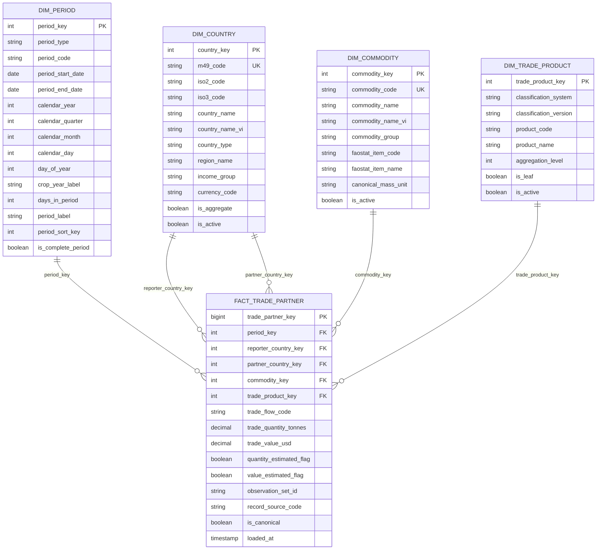

Ràng buộc: role-playing Country; unique `(period_key,reporter_country_key,partner_country_key,trade_product_key,trade_flow_code,observation_set_id)`; H3/H4/H5/H6 là các phiên bản khác nhau; không cộng mã cha và mã con; partner share dùng mẫu số cùng source, flow, product definition và period.

### F06 Weather Daily

Grain: một Weather Location × một ngày × Observation Set.

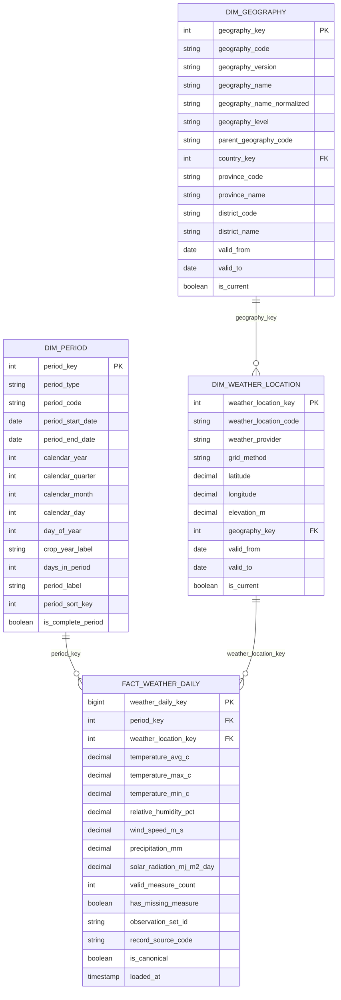

Ràng buộc: `period_type='DAY'`; mọi `-999/-999.0` đổi thành NULL; monthly temperature/humidity/wind dùng AVG có coverage, precipitation dùng SUM, max/min dùng MAX/MIN; báo cáo số ngày hợp lệ.

### F07 Coffee Ending Stock

Grain: Country × Coffee Commodity × Crop Year × Scenario × Observation Set.

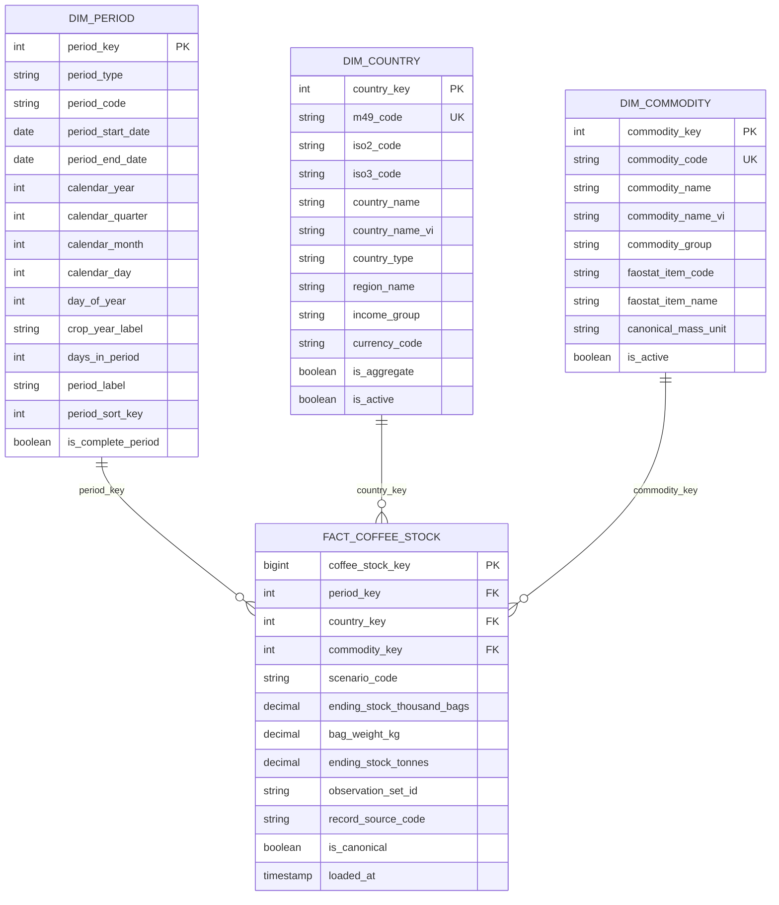

Ràng buộc: `period_type='CROP_YEAR'`; `scenario_code in ('ACTUAL','FORECAST')`; conversion hiện tại `tonnes = thousand_bags × 60`; stock semi-additive, không SUM qua nhiều crop year.

### F08 Macro Indicator

Grain: Country × Calendar Year × Macro Indicator × Observation Set. Đây là trường hợp long-format `indicator_value` hợp lý vì indicator dimension kiểm soát ngữ nghĩa.

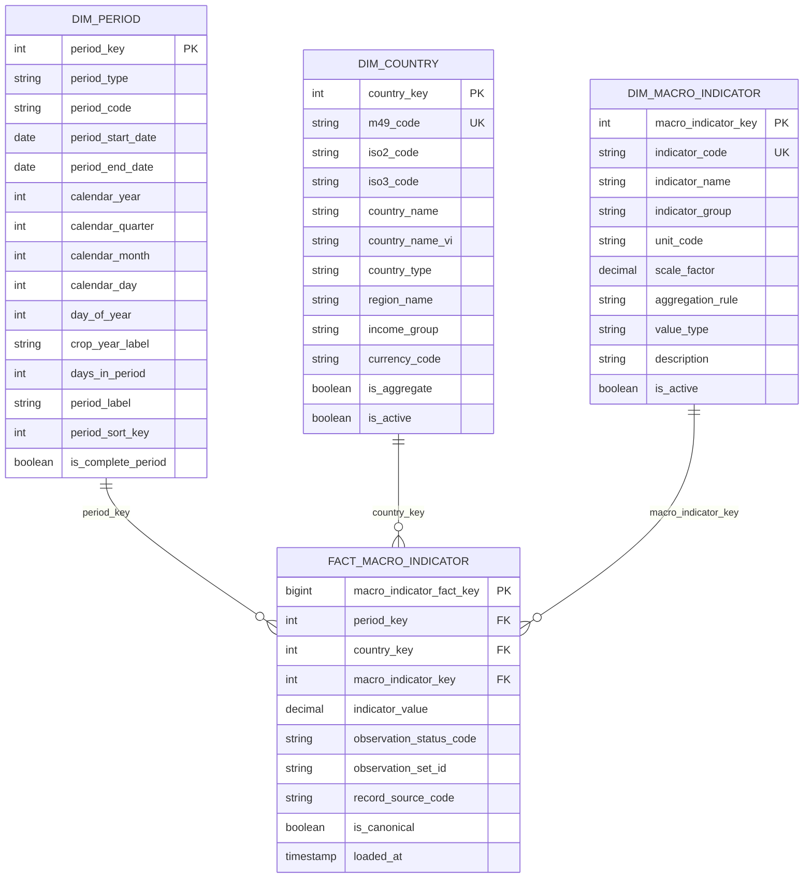

Ràng buộc: `period_type='YEAR'`; không SUM mặc định; 138 WDI NULL hiện có không được biến thành 0; aggregation theo `dim_macro_indicator.aggregation_rule`.

## Output 2 Các việc phải xử lý tại Silver

### Nguyên tắc và phạm vi Silver

Silver không phải một Data Warehouse thứ hai và không quyết định lại business model của Gold. Silver chỉ xử lý dữ liệu Bronze để đáp ứng hợp đồng đầu vào của Gold: đúng grain, mã chuẩn, kiểu dữ liệu, kỳ, đơn vị, coverage, trạng thái, chất lượng và lineage. Các tên dưới đây là tên logic gợi ý cho kết quả xử lý; có thể đổi theo convention triển khai.

Silver nên giữ observation chuẩn hóa ở dạng atomic/long khi nguồn đang long-format; việc pivot thành các measure có tên rõ ràng được thực hiện khi nạp Fact Gold.

| Nhóm dữ liệu Silver | Grain | Công việc chính | Cấp cho Gold |
|---|---|---|---|
| `silver_meta.dataset_registry` | Một dataset logic | provider, dataset code, owner, URL, license, frequency, precedence | Không join BI; phục vụ lineage. |
| `silver_meta.observation_set` | Một lần phát hành/ingestion | dataset, source file hash, release time, retrieved time, schema version, status | `observation_set_id` trong Fact. |
| `silver_meta.dq_result` | Một test × run × object | row count, fail count, threshold, sample lỗi | Chặn publish khi critical fail. |
| `silver_meta.quarantine_record` | Một dòng lỗi | payload, error code, source row locator | Không nạp Gold. |
| `silver_ref.country` | Một M49 | map M49/ISO/tên, aggregate member | `dim_country`. |
| `silver_ref.geography` | Một đơn vị hành chính/phiên bản | chuẩn hóa tỉnh/huyện, parent, valid dates | `dim_geography`. |
| `silver_ref.commodity` | Một commodity | map FAOSTAT item 656/687/836 và tên Việt | `dim_commodity`. |
| `silver_ref.trade_product` | Một classification/version/code | HS/FAOSTAT code, level, leaf; không nhúng mapping nhiều-nhiều vào một cột commodity | `dim_trade_product`. |
| `silver_ref.trade_product_commodity_bridge` | Một product-version × commodity × phiên bản mapping | mapping type, allocation weight, status, rule, valid dates; kiểm tra tổng trọng số | `bridge_trade_product_commodity`; chỉ cấp `commodity_key` trực tiếp cho Fact khi mapping 1:1 đã APPROVED. |
| `silver_ref.unit_conversion` | from-unit × to-unit × context | multiplier, formula, precision, valid dates | Tất cả measure chuẩn hóa. |
| `silver_ref.metric_definition` | Một metric/indicator/series | unit, datatype, aggregation, valid range | Price, Macro, quality tests. |
| `silver_core.production_observation` | country × item × year × element × observation set | Parse FAOSTAT, NULL, flag, unit | Pivot F01. |
| `silver_core.provincial_agri_observation` | geography × commodity × year × metric × scope × set | giữ tỉnh/huyện, edition, preliminary/partial | Pivot F02. |
| `silver_core.price_observation` | series × geography scope × period × set | parse Pink Sheet, FAOSTAT, local price; dedupe | F03. |
| `silver_core.trade_total_observation` | reporter × product × flow × period × metric × set | TCL/local exports; normalized units | Pivot F04. |
| `silver_core.trade_partner_observation` | reporter × partner × product × flow × period × metric × set | FAOSTAT matrix/UN; HS version | Pivot F05. |
| `silver_core.weather_daily` | weather point × date × set | sentinel→NULL, range checks | F06. |
| `silver_core.coffee_stock_observation` | country × crop year × scenario × set | parse forecast label, bag→tonne | F07. |
| `silver_core.macro_indicator_observation` | country × year × indicator × set | unit metadata, NULL preservation | F08. |

### Hợp đồng đầu ra Silver cho từng Fact Gold

| Gold đích | Nguồn Bronze liên quan | Silver bắt buộc xử lý | Dataset đầu ra Silver phải bảo đảm |
|---|---|---|---|
| `FACT_PRODUCTION_NATIONAL` | Ba CSV FAOSTAT Production | Chuẩn hóa M49/item/year/element/unit/flag; missing flag M thành NULL; ghép Area harvested, Production, Yield đúng cùng grain | Một observation cho mỗi country-item-year-element-set; đủ ba element khi nguồn có; có thể tạo yield từ production/harvested area nếu thiếu và đánh dấu DERIVED |
| `FACT_PRODUCTION_PROVINCIAL` | Bộ 3 cây cấp tỉnh/huyện và hai file Excel cà phê | Chuẩn hóa tỉnh/huyện, năm, preliminary/partial, scope; đổi nghìn ha/tấn; phân biệt planted và harvested; hòa giải nguồn trùng | Một observation cho mỗi geography-commodity-year-metric-coverage-status-set; tạo `yield_kg_ha` khi reported hoặc khi production và harvested area cùng grain |
| `FACT_PRICE` | FAOSTAT annual/monthly, Pink Sheet, giá Đắk Lắk/Lâm Đồng | Parse series; chuẩn hóa tháng/năm; tách amount/index; gắn currency/unit/index base; xử lý trùng giá 2022; chuẩn hóa geography | Một observation cho mỗi series-scope-period-set; đúng một loại measure; không so LCU khác quốc gia; canonical winner rõ ràng |
| `FACT_TRADE_TOTAL` | FAOSTAT TCL và file xuất khẩu cà phê | Tách flow/metric từ Element; đổi tấn/nghìn tấn và USD/nghìn/triệu USD; giữ frequency | Một observation cho reporter-product-flow-period-metric-set; annual và monthly không trộn |
| `FACT_TRADE_PARTNER` | FAOSTAT Trade Matrix, UN Comtrade annual/monthly | Map reporter/partner; version hóa HS; chuẩn hóa net weight/value; xử lý aggregate/leaf/estimated/reported | Một observation cho reporter-partner-product-version-flow-period-metric-set; không lẫn mã cha-con; source winner rõ ràng |
| `FACT_WEATHER_DAILY` | NASA POWER daily | YEAR+DOY thành date; -999 thành NULL; range checks; chuẩn hóa điểm/tọa độ và đơn vị | Một dòng mỗi location-date-set; không duplicate; có quality/coverage fields |
| `FACT_COFFEE_STOCK` | Excel tồn kho cà phê | Parse crop year; tách forecast/actual; chuẩn hóa country; đổi nghìn bao 60kg sang tonnes | Một observation mỗi country-crop year-scenario-set; giữ giá trị gốc và giá trị tấn |
| `FACT_MACRO_INDICATOR` | WDI | Chuẩn hóa indicator/country/year; map unit, scale, aggregation rule; giữ NULL | Một observation mỗi country-year-indicator-set; không biến NULL thành 0 |

### Source selection policy

`is_canonical` không được gán bằng một quy tắc chung cho mọi domain. Silver phải có bảng điều khiển `silver_meta.source_selection_policy` với cấu trúc tối thiểu:

| Cột | Ý nghĩa |
|---|---|
| `policy_code` | Mã chính sách duy nhất |
| `business_process` | Production, Price, Trade Total, Trade Partner, Weather, Stock hoặc Macro |
| `metric_code` | Measure được áp dụng |
| `grain_scope` | Các trường tạo phạm vi so sánh ứng viên |
| `period_type` | DAY, MONTH, YEAR hoặc CROP_YEAR |
| `geography_level` | WORLD, COUNTRY, PROVINCE, DISTRICT hoặc WEATHER_POINT |
| `coverage_code` | ALL_PRODUCERS, SMALLHOLDER_ONLY, PARTIAL_TO_DATE... |
| `candidate_source_code` | Nguồn được phép tham gia |
| `source_priority` | Thứ tự ưu tiên trong cùng phạm vi tương đương |
| `allowed_record_status` | FINAL, PRELIMINARY, FORECAST... |
| `allowed_quality_flags` | Cờ chất lượng hợp lệ; cờ bị loại phải khai báo rõ |
| `effective_from`, `effective_to` | Khoảng hiệu lực của policy |
| `tie_break_rule` | Quy tắc xử lý khi cùng priority |
| `conflict_action` | BLOCK, QUARANTINE hoặc REQUIRE_REVIEW |

Hai bản ghi chỉ được coi là ứng viên cạnh tranh khi chúng cùng business grain, metric definition, unit chuẩn, coverage, frequency, product classification/version và scenario. Hai nguồn có ý nghĩa khác nhau phải trở thành hai series/dataset khác nhau, không được dùng source priority để ép chọn một.

| Business process | Phạm vi canonicalization | Điều kiện hợp lệ | Chính sách ban đầu | Khi hòa |
|---|---|---|---|---|
| National Production | Country × Commodity × Year × Metric | M49/item/year hợp lệ; value khác NULL; unit đúng metric | FAOSTAT release mới nhất; giữ nguyên A/E/I/X, loại M khỏi candidate value | Cùng value: release mới nhất; khác value: quarantine/review |
| Provincial Production | Geography × level × Commodity × Year × Metric × Coverage × Status | Không lẫn province/district; không lẫn full/smallholder/partial | Province total chính thức thắng bản tổng hợp lại từ district tại cùng grain; preliminary không thay final; smallholder là coverage riêng | Khác value ở cùng rank: block publish grain đó |
| Price | Series definition × Scope × Period | Cùng price type, currency, unit, index base, frequency và market scope | Chọn release mới nhất trong cùng `series_code`; FAOSTAT LCU, Pink Sheet và giá địa phương không cạnh tranh nếu khác series | Khác value cùng release/rank: quarantine |
| Trade Total | Reporter × Classification/version × Product × Flow × Period × Metric | Cùng frequency và product definition; unit conversion hợp lệ | TCL, local export và UN aggregate chỉ cạnh tranh nếu mapping chứng minh tương đương; mặc định giữ dataset series riêng | Không tương đương: không chọn chéo; tương đương nhưng hòa khác value: review |
| Trade Partner | Reporter × Partner × Classification/version × Product × Flow × Period × Metric | Không lẫn HS version; không lẫn parent/leaf; customs/mode scope tương thích | FAOSTAT item và UN HS là hai product definitions; chỉ chọn trong cùng definition/release | Khác value cùng rank: quarantine |
| Weather Daily | Location × Day × Metric | Không sentinel; range hợp lệ | NASA POWER observation set hợp lệ mới nhất | Hai giá trị khác nhau cùng release: block |
| Coffee Stock | Country × Crop Year × Scenario | Scenario, bag weight và unit hợp lệ | Release mới nhất trong cùng ACTUAL hoặc FORECAST; forecast không thay actual | Khác value cùng rank: review |
| Macro Indicator | Country × Year × Indicator | Indicator/unit/scale hợp lệ | WDI release mới nhất; NULL không cạnh tranh với giá trị hợp lệ nhưng vẫn được giữ lineage | Hai non-null khác nhau cùng rank: review |

Thứ tự quyết định chuẩn:

1. Lọc ứng viên đúng semantic grain và policy hiệu lực.
2. Loại bản ghi vi phạm validation bắt buộc.
3. So `source_priority` trong đúng phạm vi tương đương.
4. Ưu tiên FINAL hơn PRELIMINARY chỉ khi policy cho phép hai status cạnh tranh.
5. Ưu tiên `published_at` mới hơn, sau đó `source_version` mới hơn.
6. `ingested_at` chỉ phá hòa giữa hai lần nạp của cùng một release, không được làm nguồn kém chất lượng thắng.
7. Nếu vẫn hòa và giá trị bằng nhau, giữ một winner có lineage đến cả hai candidate.
8. Nếu vẫn hòa nhưng giá trị khác nhau, không gán `is_canonical=true`; ghi conflict và thực hiện `conflict_action`.

### Checklist xử lý theo nguồn

#### 1. Kiểm soát ingestion và lineage

- Tạo SHA-256 cho file, giữ `source_file_name`, `source_uri`, `retrieved_at`, `published_at`, `file_modified_at`, `schema_version`, `row_number`.
- Không dùng đường dẫn máy cục bộ trong dữ liệu (`data\bronze\...`) làm business key.
- Mỗi lần nạp tạo `observation_set_id`; xác định `is_current`, `is_superseded`, `supersedes_observation_set_id`.
- Phân biệt source release mới với chạy lại cùng file. Cùng hash thì idempotent, không tạo observation mới.
- Quản lý tập trung `source_selection_policy` theo domain, grain, metric và thời gian hiệu lực; không hard-code thứ tự nguồn rải rác trong dbt model.

#### 2. Chuẩn hóa mã và tên

- M49 phải giữ dạng string có padding ba chữ số; map ISO2/ISO3 và aggregate code `001=World`.
- Chuẩn hóa Unicode NFC, dấu tiếng Việt, khoảng trắng và alias: Đăk/Đắk, TP.HCM/Hồ Chí Minh, China variants.
- Tạo mã ổn định cho tỉnh/huyện; `district` không được bỏ. Mapping có `valid_from/valid_to` để xử lý thay đổi hành chính.
- FAOSTAT item 656/687/836 map vào commodity; HS 0901/0904 và các mã cao su map bằng bridge có trạng thái `APPROVED/PENDING/REJECTED`.
- Không mặc định một HS code luôn 1:1 với commodity ở mọi phiên bản.

#### 3. Thời gian

- Parse FAOSTAT annual/monthly thành `period_type` rõ ràng; annual code 7021 không được coi là tháng.
- UN Comtrade `period=YYYYMM` và `period=YYYY` phải giữ frequency; không cộng annual cùng monthly.
- Parse `Sơ bộ năm 2024` thành year=2024 + `record_status_code='PRELIMINARY'`.
- Parse `Dự báo 2025/2026` thành crop year + `scenario_code='FORECAST'`; không trộn với actual.
- NASA `YEAR+DOY` phải đổi thành date thật và kiểm tra leap year.
- Partial period `to July 2025` phải có `coverage_end_date` hoặc coverage code; không so trực tiếp với full year.

#### 4. Unit, currency và scale

- `t`, `tonnes`, `Tấn` → tonne; `1000 USD` × 1000; `triệu USD` × 1.000.000; `nghìn tấn` × 1000; `nghìn ha` × 1000.
- `nghìn bao (60kg/bao)` → tonnes bằng `value × 60`, đồng thời giữ số liệu gốc.
- `Đồng/kg` → VND/tonne bằng ×1000 nếu cần; không gắn nhãn USD khi chưa có tỷ giá đúng kỳ.
- LCU phải đi kèm country/currency context. Không so LCU giữa các quốc gia.
- Producer Price Index có unit rỗng nhưng không phải dữ liệu lỗi; series metadata phải ghi base `2014-2016=100`.
- Pink Sheet monthly price và monthly index là hai series khác nhau; không đưa vào cùng measure.

#### 5. Dedupe và chọn bản ghi chuẩn

- Giá địa phương 2022: quarantine 24 dòng trùng khóa; so sánh source row/time. Không dùng `dropDuplicates` ngẫu nhiên. Chọn bằng rule có thứ tự và lưu loser record.
- Provincial 3-crops: natural key phải có geography level và district. Nếu dashboard cấp tỉnh, chỉ dùng `province total` hoặc aggregate district sau khi chứng minh đầy đủ; không cộng cả hai.
- `smallholder rubber only` không được đại diện toàn tỉnh; `PARTIAL_TO_DATE` không được trộn full year.
- FAOSTAT production và price không có duplicate natural key trong tệp hiện tại, nhưng uniqueness test vẫn bắt buộc.
- Chọn canonical source đúng bảng `source_selection_policy`: candidate hợp lệ → source priority → status → publication/source version → ingestion của cùng release; conflict khác giá trị thì không có winner và không chọn theo file name.

#### 6. Xử lý riêng theo domain

**Production**

- Giữ long-format tại Silver với `element_code`, `value`, `unit`, `flag`.
- Validate công thức gần đúng `production_tonnes*1000 / area_harvested_ha ≈ yield_kg_ha`; chỉ cảnh báo do rounding/ước tính.
- Pivot sang Gold bằng conditional aggregation và giữ `area_flag`, `production_flag`, `yield_flag` riêng.
- Missing flag `M` → measure NULL, không thành 0.

**Price**

- `series_code` phải bao gồm provider/dataset, commodity, element/price type, scope, currency/unit, frequency và variant.
- Pink Sheet: chỉ parse các sheet cần thiết; bỏ header trang trí, dấu `…`, mismatch sheet khỏi observation.
- Lưu provenance của series description và index base.
- Chuẩn hóa hai cột Đắk Lắk/Lâm Đồng thành hai dòng geography riêng, không giữ wide ở Silver.

**Trade**

- Chuẩn hóa Element thành `flow_code` + `metric_code`; sau đó pivot quantity/value chỉ khi cùng grain.
- UN Comtrade: map reporter/partner từ code vì label đang trống; giữ `classificationCode` làm version; filter thống nhất customs/mode/partner2.
- Xác định canonical quantity: ưu tiên `netWgt` cho mass khi hợp lệ; không tự dùng `qty` nếu unit không phải mass.
- Giữ cờ `isQtyEstimated`, `isNetWgtEstimated`, `legacyEstimationFlag`, `isReported`, `isAggregate` để đánh giá chất lượng.
- Không cộng mã HS cha và con; kiểm tra `aggrLevel/isLeaf`.
- Reconcile annual với SUM(monthly) theo tolerance nhưng không thay thế tự động.

**Weather**

- Đổi `-999` thành NULL trước range check.
- Kiểm tra `T2M_MIN <= T2M <= T2M_MAX`, RH 0-100, precipitation >=0, wind >=0.
- Giữ lat/lon và mapping geography có hiệu lực. Một điểm đại diện tỉnh không đồng nghĩa trung bình không gian toàn tỉnh.
- Tạo monthly aggregate riêng với `valid_day_count`, `expected_day_count`, `coverage_pct`.

**Stock và Macro**

- Stock: tách scenario actual/forecast; validate 60 kg/bag; stock không cộng qua thời gian.
- WDI: unit/rule đến từ indicator registry; 138 NULL giữ nguyên; không forward-fill mặc định.
- Exchange rate annual chỉ cho phép chuyển đổi annual hoặc đánh dấu xấp xỉ; không dùng để tạo monthly USD price như giá trị chính xác.

### Data quality gates trước Gold

| Gate | Điều kiện pass |
|---|---|
| Composite uniqueness | Không duplicate trên toàn bộ tổ hợp business key/natural grain; không kiểm tra unique riêng từng thành phần của khóa tổ hợp. |
| Referential integrity | 100% key map được hoặc vào UNKNOWN có reason code; không FK NULL. |
| Unit validity | Mọi measure có unit hợp lệ và conversion rule versioned. |
| Period validity | Fact chỉ dùng period type cho phép; annual/monthly/crop-year không lẫn. |
| Scope validity | Không trộn province total, district, smallholder, partial-to-date trong cùng canonical grain. |
| Price geography scope | WORLD/COUNTRY/PROVINCE/DISTRICT tuân thủ đúng tổ hợp country/geography và quan hệ cha-con. |
| SCD2 temporal integrity | Mỗi business key tối đa một current row; khoảng `[valid_from, valid_to)` không overlap; Fact tra đúng phiên bản tại observation date. |
| Sentinel/null | Không còn -999; missing không đổi thành 0. |
| Trade hierarchy | Không xuất bản tập có đồng thời mã cha và con trong cùng aggregation set. |
| Trade mapping | Mapping 1:N/N:M không nhân bản measure; mapping phân bổ có trọng số APPROVED và tổng trọng số bằng 1 trong tolerance. |
| Source selection | Mỗi canonical grain có tối đa một winner; conflict chưa giải quyết có 0 winner, bị chặn/quarantine/review; loser vẫn truy vết được. |
| Measure reconciliation | Production-yield và annual-monthly nằm trong tolerance hoặc có exception. |
| Freshness | Observation set đúng SLA theo dataset; incomplete release không được promote. |

## Output 3 Bảng đánh giá và mô tả mô hình hoàn thiện

### Các vấn đề trong thiết kế hiện tại

Sáu phản biện bổ sung đã được đóng trong thiết kế này:

| ID | Phản biện | Điều chỉnh đã chốt | Vị trí kiểm soát |
|---|---|---|---|
| 3.1 | Mermaid gắn `UK` riêng cho từng cột của composite key | Bỏ `UK` riêng lẻ; công bố tổ hợp business key; triển khai bằng DDL table constraint và dbt `unique_combination_of_columns` | Quy ước mô hình + tests Gold |
| 3.2 | Chưa có quy tắc chọn nguồn đủ chi tiết | Thêm `source_selection_policy` theo process/grain/metric/effective date, thứ tự quyết định và hành vi khi hòa/xung đột | Silver metadata + canonical models |
| 3.3 | Trade product–commodity có thể nhiều-nhiều | Tách `bridge_trade_product_commodity`; chỉ gán commodity trực tiếp khi mapping 1:1 APPROVED; mapping phân bổ phải có trọng số hợp lệ | Silver reference + Gold bridge/mart |
| 3.4 | `FACT_PRICE` có thể chứa phạm vi địa lý mâu thuẫn | Thêm ma trận constraint WORLD/COUNTRY/PROVINCE/DISTRICT và kiểm tra quan hệ geography thuộc country | Gold model tests |
| 3.5 | SCD2 chưa kiểm soát overlap và lookup theo thời điểm | Chuẩn hóa khoảng nửa mở, một current row, cấm overlap, point-in-time lookup và re-key late-arriving facts | Silver reference + dimension/fact load tests |
| 3.6 | Forecasting Mart chưa đủ để triển khai | Chốt target, origin, horizon, feature schema, availability cutoff, temporal split, model run và prediction/actual schema | Gold forecasting mart |

| Mức độ | Vấn đề | Bằng chứng | Ảnh hưởng | Điều chỉnh chốt |
|---|---|---|---|---|
| Critical | Grain dữ liệu Provincial chưa khóa cấp huyện | 2.142/2.473 dòng là district; bỏ district tạo 2.328 dòng trùng khóa biểu kiến | Double count hoặc overwrite | Giữ `FACT_PRODUCTION_PROVINCIAL`, nhưng `dim_geography` có member province/district riêng; semantic filter theo level/scope. |
| Critical | Nhiều nguồn/phiên bản cùng tồn tại nhưng không có canonical selection | FAOSTAT, UN Comtrade, local export; `observation_set_id` chỉ phân biệt chứ không chọn | Dashboard cộng lặp | Giữ lineage ở base; publish `*_canonical` theo `source_selection_policy`; xung đột chưa giải quyết có 0 winner. |
| Critical | Annual và monthly trade/price có thể bị cộng chung | UN annual + monthly; FAOSTAT price annual code 7021 | Gấp đôi số liệu | Bắt buộc period_type/frequency; semantic model cấm SUM chéo. |
| Critical | Sentinel thời tiết chưa xử lý | -999 ở 126 dòng đa biến, 5.040 solar | AVG/SUM sai nghiêm trọng | Silver sentinel→NULL + coverage count. |
| High | Giá địa phương trùng khóa | 24 dòng cùng year-month trong 2022 | Một tháng có hai giá gần giống | Quarantine, chọn winner có căn cứ, lưu loser. |
| High | Pivot Production làm mất cờ chất lượng từng measure | FAOSTAT flag A/E/I/X/M độc lập theo Element | Không biết measure nào estimated/missing | Giữ 3 flag riêng trong Gold. |
| High | `coverage_code` hiện chưa đủ ngữ nghĩa | district total, province total, smallholder only, to July 2025 | So sánh/cộng sai phạm vi | Chuẩn hóa coverage + status + geography_level. |
| High | HS classification không version hóa đầy đủ trong logic | UN đổi H3/H4/H5/H6 | Trend product không đồng nhất | Business key có classification_version; mapping bridge versioned. |
| High | LCU/SLC/USD/Index dễ bị coi là cùng giá | Annual 4 Element; monthly LCU; index unit rỗng | So sánh giá sai | `dim_price_series` định nghĩa currency/unit/index base; measures tách amount/index. |
| High | Actual và forecast stock trộn trong một grain | `Dự báo 2025/2026` cùng bảng actual | Trend lịch sử bị nhiễm forecast | Thêm `scenario_code`; canonical view mặc định ACTUAL. |
| High | Trade Total và Trade Partner chồng lấn ý nghĩa | TCL tổng quốc gia; Matrix/UN theo partner | Fan-out/double count | Hai Fact độc lập; share KPI dùng Fact Partner với mẫu số tương thích hoặc Fact Total, không join row-level. |
| Medium | `dim_period` đa grain có nguy cơ join sai | DAY/MONTH/YEAR/CROP_YEAR trong một bảng | So sánh sai kỳ | Giữ một dim nhưng enforce period_type theo Fact và view riêng theo grain. |
| Medium | WDI unit trống | 396/396 unit NULL; 138 value NULL | KPI không có ngữ nghĩa hoặc biến missing thành 0 | Indicator registry quản lý unit/rule; preserve NULL. |
| Medium | Pink Sheet chưa phải bảng phân tích | Có Description, Index Weights, Mismatch Details | Rác/header vào Fact | Parser theo sheet; chỉ xuất observation chuẩn hóa. |
| Medium | `dim_source` chưa có vai trò nghiệp vụ rõ | Source chủ yếu là metadata kỹ thuật | Phình star, người dùng group/sum theo source | Không dùng core `dim_source`; dùng meta registry/audit và reconciliation mart. |
| Medium | Geography-weather mapping bị coi là tĩnh | Hiện một điểm/tỉnh nhưng có thể thay đổi | Lịch sử gán sai tỉnh/điểm | `dim_weather_location` SCD2 với valid dates. |

### Mô tả 8 Fact hoàn thiện

| Fact | Loại | Grain canonical | Measure vật lý | Quy tắc tổng hợp chính |
|---|---|---|---|---|
| `fact_production_national` | Periodic observation | Country × Commodity × Year | area harvested, production, reported yield | Area/production additive qua country/commodity không overlap; yield weighted/recomputed. |
| `fact_production_provincial` | Periodic observation | Geography × Commodity × Year × Coverage × Status | area planted, area harvested, production, yield | Không cộng province với district; yield tổng hợp phải tính lại từ tổng production và harvested area. |
| `fact_price_observation` | Periodic observation | Price Series × Scope × Period | native/canonical price, price index | Non-additive; AVG/last tùy series, không SUM. |
| `fact_trade_total` | Periodic flow | Reporter × Product × Flow × Period | quantity tonnes, value USD | Additive trên tập product/country không overlap; unit value là ratio of sums. |
| `fact_trade_partner` | Periodic flow | Reporter × Partner × Product × Flow × Period | quantity tonnes, value USD | Additive qua partner không overlap; share/HHI tính sau aggregation. |
| `fact_weather_daily` | Periodic snapshot | Weather location × Day | temperature, humidity, wind, rain, solar | Temp/humidity/wind AVG; rain SUM; extremes MIN/MAX; luôn kèm coverage. |
| `fact_coffee_ending_stock` | Periodic snapshot | Country × Crop Year × Scenario | thousand bags, tonnes | Semi-additive; không SUM qua thời gian. |
| `fact_macro_indicator` | Generic indicator observation | Country × Year × Indicator | indicator value | Theo aggregation rule; không SUM mặc định. |

### Mô tả 8 Dimension hoàn thiện

| Dimension | Dùng bởi Fact | Quy tắc quan trọng |
|---|---|---|
| `dim_period` | Tất cả | Role-playing theo period_type; Type 0; không sửa lịch sử kỳ. |
| `dim_commodity` | Production, Price, Trade, Stock | Conformed 3 cây; FAOSTAT item mapping; không thay thế trade product detail. |
| `dim_country` | Production, Price, Trade, Stock, Macro | Role reporter/partner; chứa aggregate member nhưng BI mặc định loại aggregate khi cộng quốc gia. |
| `dim_geography` | Provincial Production, Price; gián tiếp Weather | SCD2 cho thay đổi hành chính; province và district là member riêng. |
| `dim_weather_location` | Weather | SCD2; tọa độ và mapping geography có hiệu lực. |
| `dim_price_series` | Price | Khóa toàn bộ ngữ nghĩa của amount/index, currency, unit, basis, frequency. |
| `dim_trade_product` | Trade Total/Partner | Classification+version+code; hierarchy/leaf. Quan hệ commodity nằm ở bridge versioned; chỉ mapping 1:1 APPROVED mới được materialize trực tiếp vào Fact. |
| `dim_macro_indicator` | Macro | Unit, scale, value type và aggregation rule. |

### Enterprise bus matrix

| Business process | Period | Commodity | Country | Geography | Weather location | Price series | Trade product | Macro indicator |
|---|:---:|:---:|:---:|:---:|:---:|:---:|:---:|:---:|
| National production | ✓ | ✓ | ✓ |  |  |  |  |  |
| Provincial production | ✓ | ✓ |  | ✓ |  |  |  |  |
| Price | ✓ | ✓ | ✓ | ✓ |  | ✓ |  |  |
| Trade total | ✓ | ✓ | ✓ |  |  |  | ✓ |  |
| Trade partner | ✓ | ✓ | ✓ reporter/partner |  |  |  | ✓ |  |
| Daily weather | ✓ |  |  | gián tiếp | ✓ |  |  |  |
| Coffee ending stock | ✓ | ✓ | ✓ |  |  |  |  |  |
| Macro indicator | ✓ |  | ✓ |  |  |  |  | ✓ |

### KPI an toàn có thể triển khai

| KPI | Công thức | Fact | Điều kiện |
|---|---|---|---|
| Yield tổng hợp | `SUM(production_tonnes)*1000/SUM(area_harvested_ha)` | Production | Cùng geography level, coverage, period và canonical source. |
| Export unit value | `SUM(trade_value_usd)/SUM(trade_quantity_tonnes)` | Trade | Flow=EXPORT, quantity>0, cùng product definition/source. |
| Partner share | partner value / compatible total value | Trade Partner | Cùng reporter, period, product, flow và source. |
| Market HHI | `SUM(share_i^2)` | Trade Partner | Partner set đầy đủ; loại World/aggregate và unknown. |
| YoY growth | `(current/prior)-1` | Production/Trade/Price | Cùng grain, source series, status và full period. |
| Price volatility | stddev hoặc CV của monthly price | Price | Một series đồng nhất, đủ coverage; không trộn currency/index. |
| Weather monthly rain | SUM daily precipitation | Weather | Coverage threshold, ví dụ ≥90% ngày hợp lệ. |
| Weather monthly mean temperature | AVG daily T2M | Weather | Kèm valid_day_count/expected_day_count. |
| Stock-to-export ratio | ending stock / export quantity | Stock + Trade | Cần map crop-year với trade period có quy tắc công bố; không join row-level. |
| Export concentration | top-N share hoặc HHI | Trade Partner | Cùng definition và đủ partner coverage. |

### Cấu trúc semantic và aggregate hỗ trợ

- `gold_semantic.production_national_canonical`
- `gold_semantic.production_provincial_canonical`
- `gold_semantic.price_canonical`
- `gold_semantic.trade_total_canonical`
- `gold_semantic.trade_partner_canonical`
- `gold_semantic.weather_daily_canonical`
- `gold_semantic.coffee_stock_actual`
- `gold_semantic.macro_indicator_canonical`
- `gold_agg.weather_monthly_by_province`
- `gold_agg.trade_partner_market_share_yearly`
- `gold_agg.production_yearly_comparison`
- `gold_mart.forecasting_monthly_features`, `gold_mart.forecast_model_run` và `gold_mart.forecast_prediction` theo định nghĩa dưới đây.

### Forecasting Mart hoàn chỉnh

#### Bài toán dự báo chốt

| Thành phần | Định nghĩa |
|---|---|
| Target | `monthly_export_quantity_tonnes` |
| Đối tượng | Việt Nam × Commodity (coffee, natural rubber, pepper) |
| Tần suất | Tháng |
| Forecast origin | Tháng cuối cùng mà toàn bộ feature dùng cho lần dự báo đã được công bố |
| Horizon | 1, 3 và 6 tháng |
| Target period | `origin_period + horizon` |
| Canonical target source | Một source series nhất quán cho toàn bộ history; không nối FAOSTAT/UN/local theo thời gian nếu chưa có reconciliation policy |
| Baseline | Seasonal naive `y(t-12)` và naive `y(t)` |
| Metrics | MAE, RMSE, sMAPE; MAPE chỉ dùng khi actual khác 0 |

Nếu sau này chọn target khác như export value hoặc price, phải tạo `forecast_target_code`/series riêng; không thay đổi ý nghĩa target trong cùng model run.

#### Feature table

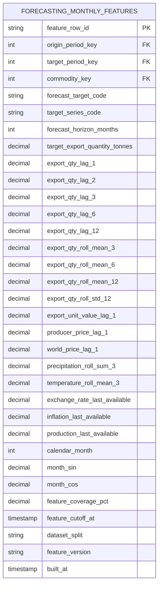

Grain: một Forecast Origin × Target Period × Commodity × Target Series × Horizon × Feature Version.

Quy tắc feature:

- Tất cả lag/rolling của target kết thúc tại forecast origin, không chạm target period.
- Price, weather, macro và production chỉ được dùng khi `available_at <= feature_cutoff_at`.
- Annual production/macro dùng bản gần nhất đã công bố tại origin; không backfill số liệu công bố sau origin vào lịch sử feature.
- Weather aggregate phải đạt coverage threshold; nếu không đạt, để NULL và ghi giảm `feature_coverage_pct`.
- `target_export_quantity_tonnes` có giá trị trong tập train/validation/test đã quan sát; để NULL cho future scoring rows.
- Mọi lần build phải có `feature_version` và snapshot source versions để tái lập.

#### Model run và prediction

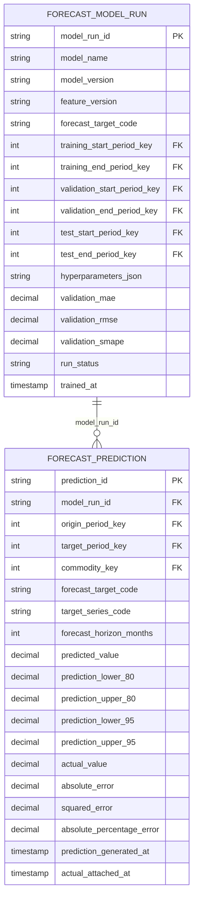

#### Cutoff và chống leakage

Điều kiện bắt buộc cho mọi nguồn feature:

```text
source_record.available_at <= feature_cutoff_at
```

`available_at` là thời điểm dữ liệu thực sự có thể được biết, không phải observation period. Nếu nguồn không có publication timestamp, phải sử dụng ingestion timestamp đầu tiên được ghi nhận và đánh dấu mức tin cậy thấp hơn.

Không được:

- Dùng annual total để dự báo một tháng nằm trong chính năm đó nếu annual total chỉ được công bố sau cuối năm.
- Dùng revision mới nhất để xây lại feature lịch sử mà không có point-in-time snapshot.
- Tính rolling window có chứa target period.
- Random split các hàng theo tháng.

#### Train validation test split

Với mỗi commodity và target series:

1. Sắp xếp theo target period.
2. Giữ 24 tháng cuối có actual làm test.
3. Giữ 12 tháng ngay trước test làm validation.
4. Phần còn lại làm train và phải có tối thiểu 60 tháng sau khi tạo lag 12.
5. Nếu không đủ tối thiểu, chỉ chạy baseline và ghi `run_status='INSUFFICIENT_HISTORY'`.
6. Đánh giá riêng từng horizon và từng commodity, sau đó mới báo cáo weighted/global metrics.

Trong quá trình tuning nên dùng expanding-window validation; test set chỉ được đánh giá một lần cho báo cáo cuối.

### Thứ tự triển khai

1. Khóa reference data, observation set, unit conversion và geography version.
2. Hoàn thiện Silver atomic tables và quarantine.
3. Viết tests natural grain, sentinel, unit, period, scope và mapping.
4. Nạp 8 Dimension, sau đó 8 Fact base.
5. Xây canonical source selection và reconciliation report.
6. Xây aggregate/semantic models; dashboard chỉ truy cập semantic layer.
7. Chạy backfill, so sánh tổng theo nguồn và kiểm thử KPI.
8. Chỉ sau khi canonical views ổn định mới xây forecasting mart.

## Quyết định cuối cùng về mô hình hiện tại

Mô hình hiện tại là một bản logical design tốt để tiếp tục, nhưng chưa phải physical design sẵn sàng triển khai. Có thể giữ khung 8 Fact + 8 Dimension và tên `FACT_PRODUCTION_PROVINCIAL` nếu thực hiện các thay đổi bắt buộc sau: cho `DIM_GEOGRAPHY` biểu diễn đúng cả tỉnh/huyện; giữ đầy đủ area, production và yield; version hóa geography và trade classification; bảo toàn cờ chất lượng; đưa scenario/coverage/status vào grain; xử lý source selection ngoài `dim_source`; chuẩn hóa period/frequency; và cung cấp canonical semantic views chống double counting. Nếu không thực hiện các điểm này, schema vẫn chạy được về kỹ thuật nhưng rất dễ trả về KPI sai.
