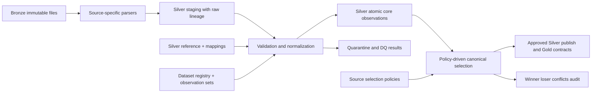

# SILVER V2 — AUDIT, TÁI THIẾT KẾ VÀ TRIỂN KHAI TỪ BRONZE

> **Implementation Runbook / Agent Handoff** — 2026-10-15
> **Tài liệu thiết kế đích có ưu tiên cao nhất:** `Thiet_ke_Gold_hoan_chinh_va_xu_ly_Silver_tu_Bronze(1).md` (bản Gold/Silver mới, 8 Facts + 8 Dimensions).
> **Đầu vào hệ thống:** Bronze hiện có và Silver v1 đang chạy trên máy người dùng.
> **Đích:** Silver v2 tương thích Gold mới, có dữ liệu truy vết, kiểm thử, publish an toàn và rollback.
> **Tình trạng:** Đây là **kế hoạch thi công và hợp đồng kỹ thuật**, **không phải báo cáo đã audit máy/repository**. Mọi câu lệnh và tên bảng mẫu phải được đối chiếu môi trường trước khi chạy.

---

## 0. MỤC TIÊU VÀ NGUYÊN TẮC BẤT BIẾN

**Yêu cầu bắt buộc:** Lấy thiết kế Gold mới làm chuẩn, kiểm tra hiện trạng Silver v1 rồi chỉ sửa/giữ/thêm những gì cần thiết. Không nâng cấp dựa trên Gold cũ; không xóa hoặc ghi đè dữ liệu trước khi kiểm chứng.

1. **Bronze immutable:** Không cập nhật/xóa các file Bronze gốc. Bronze → Silver phải tái chạy được và idempotent.
2. **Silver giữ đúng observation nguồn:** Khi nguồn dạng long thì Silver giữ atomic/long, Gold mới pivot sang named measures.
3. **Không diễn giải dữ liệu thiếu thành 0.** Giữ NULL, cờ nguồn, reason code.
4. **Tách source semantics:** FAOSTAT, UN Comtrade, dữ liệu địa phương, Pink Sheet không tự xem là các giá trị thay thế cho nhau.
5. **Không double count:** Không gộp COUNTRY/WORLD, Province/District, HS parent/child, Annual/Monthly, Actual/Forecast.
6. **Lineage per record, per measure khi cần:** Giữ liên kết về Bronze file/hash/row, dataset/release, ingestion run và policy chọn nguồn.
7. **Chọn canonical theo chính sách có version và evidence:** Không `dropDuplicates()` vô điều kiện, không chọn ngẫu nhiên theo thời điểm ingest.
8. **Publish nguyên tử:** Silver v2 staging → test → promote; Gold chỉ đọc bảng/view đã được phê duyệt.
9. **Không tự tạo nguồn dữ liệu:** Nếu thiếu field thực tế, khai báo nullable/derived với điều kiện và ghi rủi ro; không bịa giá trị.
10. **Mỗi bước phải có bằng chứng:** Log SQL/test/output, row counts, dữ liệu lỗi và người/phương thức phê duyệt.

### Phân định phạm vi

- **Trong phạm vi:** audit Silver v1, catalog/tables, schema evolution, dữ liệu đầu vào Bronze, ref/mapping/meta, chuẩn hóa 8 domain observation, kiểm thử, chuyển đổi/migration, kết nối đầu ra với Gold mới.
- **Ngoài phạm vi ngay lúc này:** xây lại 8 Fact Gold, dashboard Power BI, mô hình ML. Chỉ tạo **contracts** và smoke test để bảo đảm Gold mới nhận dữ liệu đúng.
- **Không thể kết luận khi chưa audit:** tên DAG/SQL files thật, vị trí bucket/namespace, chất lượng Silver v1, tần suất chạy thực tế, số liệu reconciliation.

---

## 1. THỨ TỰ THI CÔNG BẮT BUỘC CHO CODING AGENT

**AGENT: không chỉnh code ngay. Bắt đầu từ P0 DISCOVER.** Báo cáo hiện trạng cho người dùng; nếu thiếu quyền truy cập repo, Docker/MinIO, Catalog hoặc Bronze thì nêu blocker thay vì giả định. Mọi thay đổi destructive cần user approval riêng.

| Phase | Tên | Deliverable | Gate để qua phase |
|---|---|---|---|
| P0 | Inventory, audit và backup | `reports/silver_v1_inventory.md`, schema dump, DAG dependency map, snapshot/backup plan | Biết Silver v1 tồn tại ở đâu, ai dùng, dữ liệu nguồn nào |
| P1 | Gap analysis Silver v1 ↔ Gold mới | `reports/silver_v2_gap_matrix.csv`, ADR và migration plan | Mỗi bảng cũ được phân loại KEEP/ALTER/REBUILD/DEPRECATE |
| P2 | Silver metadata/reference foundation | registry, observation_set, policy, mapping, unit/metric refs | Chạy tests metadata, mã, key, SCD intervals |
| P3 | Domain pipelines v2 | 8 core Silver contracts + staging Iceberg | Test natural grain, quality và lineage từng domain |
| P4 | Canonical selection và Data Quality | winner/loser/conflict và quarantine có thể truy vết | Không có conflicting winner hay duplicate canonical |
| P5 | Backfill và reconciliation | báo cáo row/measure/source/kỳ, diff v1-v2 | Đạt acceptance từng domain hoặc có exception có duyệt |
| P6 | Publish/cutover có kiểm soát | view alias/cấu hình trỏ Silver v2, smoke Gold consumers | Không phá pipeline cũ; có rollback đã thử |
| P7 | Handover | README vận hành, runbook, test artifacts, issue backlog | Người khác tái chạy và khôi phục được |

**Tuyệt đối không:** `DROP TABLE silver.*`, `docker compose down -v`, xóa MinIO bucket, xóa Iceberg metadata, ghi đè đường dẫn gốc, đổi tên object production khi chưa backup và approval.

---

## 2. P0 — AUDIT SILVER HIỆN CÓ TRÊN MÁY

### 2.1. Tìm project và inventory code

Chạy tại root repository hiện có. Các lệnh sau **chỉ đọc**:

```bash
pwd
find . -maxdepth 3 -type f \( -name 'compose.yaml' -o -name 'docker-compose.yml' -o -name 'dbt_project.yml' -o -name 'pyproject.toml' -o -name 'requirements.txt' \) -print
find . -maxdepth 6 -type f \( -iname '*silver*' -o -iname '*bronze*' -o -iname '*schema*yml' \) -print
rg -n --glob '*.{py,sql,yml,yaml,md}' 'silver|bronze|iceberg|MERGE INTO|writeTo|saveAsTable|CREATE TABLE|source\(' . || true
git status --short
git branch --show-current
git log -5 --oneline
```

Không dựa hoàn toàn vào tên file: mở source code jobs, DAG, mapping, schema để tìm output thực và dependency. Nếu `rg` chưa cài, dùng `grep -RIn` có scope tương ứng.

### 2.2. Kiểm kê Docker, Airflow, Iceberg, Trino, MinIO

```bash
docker compose config --services
docker compose ps
# Dùng service thực tế lấy ở trên, KHÔNG giả định tên container.
# Nếu có Trino CLI: SHOW CATALOGS; SHOW SCHEMAS FROM iceberg;
# Nếu có Airflow: airflow dags list và airflow dags list-runs <dag_id>.
```

**Trino SQL tham khảo — sửa tên catalog/schema sau DISCOVER:**

```sql
SHOW CATALOGS;
SHOW SCHEMAS FROM iceberg;
SHOW TABLES FROM iceberg.silver;
SHOW CREATE TABLE iceberg.silver.<actual_table>;
DESCRIBE iceberg.silver.<actual_table>;
SELECT COUNT(*) FROM iceberg.silver.<actual_table>;
```

Với từng bảng, xuất: `catalog`, `schema`, `name`, `schema columns/types`, `partition spec`, `file format`, `Iceberg snapshot ID`, `record count`, `min/max period`, `null counts`, `natural grain duplicate counts`, `dataset source`, `last ingest`, `DAG/job writer`, `downstream reader`. Đối chiếu schema trong Iceberg và Spark, tránh chỉ đọc README.

Nếu quyền hỗ trợ Iceberg metadata tables, có thể xem `<table>$snapshots`, `<table>$history`, `<table>$files` trên Trino (tính năng phụ thuộc phiên bản/catalog). Không chạy câu lệnh metadata chưa được hỗ trợ.

### 2.3. Đánh giá Silver v1 theo contract mới

| Kiểm tra | Câu hỏi audit | Bằng chứng tối thiểu |
|---|---|---|
| Bronze completeness | Mỗi raw file có xuất hiện trong registry và đã ingest? | File manifest, hash, count |
| Natural grain | Silver có mất `district`, `source_scope`, `classification_version`, `metric`? | Schema + duplicate SQL |
| Unit | Có lưu đơn vị gốc/canonical và quy tắc đổi? | Unit conversion report |
| Period | Annual/monthly/day/crop-year có tách? | Group period_type |
| Quality | FAOSTAT flags, Comtrade quality, NASA `-999` còn không? | Null/sentinel counts |
| Version | Có release, file hash và rerun idempotency? | Observation-set report |
| SCD | Geography/location/price series có lịch sử, point-in-time? | Overlap/gap SQL |
| Canonical | Dashboard có cộng nhiều source/release? | Consumer lineage/SQL |
| DQ | Có quarantine, conflict và fail-fast? | DQ logs/tables |
| Downstream | Gold model/DAG/report nào phụ thuộc Silver v1? | Dependency graph |

### 2.4. Quy tắc phân loại từng asset v1

- `KEEP`: grain, units, status, lineage và tests phù hợp hoàn toàn; chỉ đăng ký interface.
- `ALTER`: thay đổi additive an toàn (thêm cột nullable/ref, không phá consumer); dùng v2 staging/schema evolution sau test.
- `REBUILD`: mất grain, gộp nghĩa sai, làm rơi flags, merge nhiều nguồn không truy vết; tái dựng từ Bronze.
- `DEPRECATE`: logic theo Gold cũ không còn consumer sau cutover; chỉ ngừng dùng, **chưa DROP**.
- `UNKNOWN`: không có bằng chứng; dừng quyết định và ghi blocker.

**Mẫu gap matrix:**

| v1_table/job | current_grain | current_fields | target_v2 | action | data_loss_risk | downstream | tests | owner | status |
|---|---|---|---|---|---|---|---|---|---|
| `<fill>` | `<inspect>` | `<inspect>` | `<contract>` | KEEP/ALTER/REBUILD/DEPRECATE | HIGH/MED/LOW | `<inspect>` | `<plan>` | `<fill>` | PENDING |

### 2.5. Backup và bảo vệ hệ thống

Trước migration: chụp metadata/snapshot ID từng bảng Iceberg, export cấu hình DAG/dbt/SQL, tạo Git branch `feat/silver-v2-migration`, ghi lại commit hiện hành, lưu manifest Bronze (đặc biệt hash). Backup/copy bảng v1 nếu cần theo khả năng catalog/storage và kiểm tra khôi phục trên môi trường thử nghiệm. **Không xem Iceberg snapshot retention là backup dài hạn** khi có tiến trình expire snapshots.

---

## 3. KIẾN TRÚC SILVER V2 MỤC TIÊU



**Các namespace logic (tên schema vật lý xác nhận ở P0):**

- `silver_meta`: source manifests, observation sets, runs, policies, DQ, quarantine, conflicts.
- `silver_ref`: mappings/definitions/versioned reference data.
- `silver_core`: atomic standardized observations cho tám business process.
- `silver_stage`: output tạm chưa publish (nên phân biệt rõ namespace hoặc table suffix versioned).

Khi Trino/Spark dùng cùng Iceberg REST Catalog, tạo bảng trong catalog thực tế, không giả định lệnh SQL Spark và Trino hoàn toàn tương thích. Mô tả ở đây là **schema logical contract**, không phải DDL chạy nguyên xi.

---

## 4. SCHEMA CONTRACT — `silver_meta` (BẮT BUỘC)

### 4.1. `dataset_registry` — một logical dataset

| Column | Logical type | Meaning / rule |
|---|---|---|
| `dataset_id` | STRING PK logical | Mã bất biến, unique |
| `provider` | STRING | FAOSTAT/UNCOMTRADE/WORLDBANK/NASA/LOCAL |
| `dataset_code` | STRING | Mã nguồn nghiệp vụ |
| `dataset_name` | STRING | Tên |
| `source_uri` | STRING | Địa chỉ nguồn đáng tin cậy |
| `license_info` | STRING nullable | Điều kiện sử dụng khi biết |
| `owner` | STRING nullable | Người phụ trách |
| `expected_frequency` | STRING | DAILY/MONTHLY/YEARLY/ADHOC |
| `source_schema_version` | STRING | Bản schema được kiểm chứng |
| `is_active` | BOOLEAN | Có cho ingest |
| `created_at`, `updated_at` | TIMESTAMP | Audit |

### 4.2. `observation_set` — một phiên bản phát hành có định danh

| Column | Logical type | Meaning / rule |
|---|---|---|
| `observation_set_id` | STRING PK logical | Mã ổn định, không sinh mới cho cùng release+hash |
| `dataset_id` | STRING | Tham chiếu registry |
| `source_file_name`, `source_uri` | STRING | Provenance |
| `file_sha256` | STRING | Kiểm toàn vẹn file |
| `file_size_bytes`, `source_record_count` | BIGINT | Manifest |
| `published_at`, `retrieved_at`, `first_seen_at` | TIMESTAMP nullable | Phân biệt công bố / tải / biết lần đầu |
| `source_version`, `schema_version` | STRING nullable | Phiên bản |
| `ingestion_run_id` | STRING | Lần chạy tạo version |
| `status` | STRING | DISCOVERED/STAGED/VALIDATED/PUBLISHED/REJECTED/SUPERSEDED |
| `supersedes_observation_set_id` | STRING nullable | Quan hệ thay thế |
| `created_at`, `updated_at` | TIMESTAMP | Audit |

**Identity rule:** dùng deterministic ID từ `dataset_id + source_version/release_identifier + file_sha256` (escape/serialize có chuẩn). Không dùng thời điểm hiện tại/random ID làm identity của một bản phát hành. Một file tải lại có cùng hash và release phải no-op; run ID có thể khác nhưng observation_set không đổi.

### 4.3. `ingestion_run`

`ingestion_run_id`, `dag_id`, `task_id`, `started_at`, `finished_at`, `code_commit`, `environment`, `run_status`, `rows_read`, `rows_valid`, `rows_quarantined`, `rows_published`, `error_summary`. Một source release có thể được kiểm tra bởi nhiều run; tách thực thể run khỏi observation_set.

### 4.4. `source_selection_policy`

`policy_code`, `policy_version`, `business_process`, `metric_code`, `grain_scope`, `period_type`, `geography_level`, `coverage_code`, `candidate_source_code`, `source_priority`, `allowed_record_status`, `allowed_quality_flags`, `effective_from`, `effective_to`, `tie_break_rule`, `conflict_action`, `is_active`, `approved_by`, `approved_at`.

**Grain:** mỗi policy/version × phạm vi áp dụng × candidate source. Không để hai rules cùng rank/điều kiện áp dụng tạo kết quả mơ hồ. Policy là cấu hình được version control, mọi sửa đổi phải có tests và duyệt. Không tự xem `latest file` là canonical.

### 4.5. `canonical_decision` / `canonical_conflict`

- `canonical_decision`: `business_process`, `metric_code`, `canonical_business_key`, `candidate_observation_id`, `observation_set_id`, `policy_code`, `policy_version`, `selection_rank`, `decision_status` (WINNER/LOSER/EXCLUDED), `decision_reason`, `decided_at`, `published_snapshot_id`.
- `canonical_conflict`: `conflict_id`, `business_process`, `metric_code`, `canonical_business_key`, `candidate_ids_json`, `conflicting_values_json`, `conflict_reason`, `conflict_action`, `resolution_status`, `resolved_by`, `resolved_at`.
- **Một winner tối đa mỗi canonical key/metric/policy context.** Conflict chưa giải quyết có **0 winner**. Duy trì history của quyết định thay vì silently overwrite.

### 4.6. `dq_result`, `quarantine_record`

- `dq_result`: `dq_result_id`, `run_id`, `object_name`, `rule_code`, `severity`, `checked_count`, `failed_count`, `threshold`, `status`, `sample_ref`, `checked_at`.
- `quarantine_record`: `quarantine_id`, `run_id`, `dataset_id`, `observation_set_id`, `source_row_locator`, `raw_payload_json`, `error_code`, `error_detail`, `severity`, `quarantine_at`, `resolution_status`, `resolution_note`.
- Không bỏ data lỗi; lỗi hard BLOCK không promote dataset, lỗi individual row được quarantine nếu contract cho phép; giữ row counts reconciliation.

---

## 5. SCHEMA CONTRACT — `silver_ref`

| Table | Grain / logical columns | Validation chính |
|---|---|---|
| `country` | `m49_code`, `iso2_code`, `iso3_code`, names, `country_type`, `is_aggregate`, validity/source | M49 string 3 digit (khi hợp lệ); World/region riêng, không cộng cùng country |
| `commodity` | `commodity_code`, names, `faostat_item_code`, `commodity_group`, active | Chỉ approved code dùng Gold; không coi HS 1:1 |
| `geography` | `geography_code`, `geography_version`, names, `geography_level`, `province_code`, `district_code`, parent, `valid_from`, `valid_to`, alias | District và Province riêng; không-overlap hiệu lực trong từng business identity |
| `geography_alias` | `source_dataset`, `raw_name`, `raw_code`, `normalized_name`, `geography_code`, `confidence`, `approval_status`, effective dates | Không fuzzy-auto-approve mapping chưa chắc chắn |
| `weather_location` | `weather_location_code`, `latitude`, `longitude`, provider, `geography_code`, `valid_from`, `valid_to`, method | History point-to-province, one valid mapping per policy/time |
| `trade_product` | `classification_system`, `classification_version`, `product_code`, `product_name`, `aggregation_level`, `is_leaf` | Unique composite; preserve leading zeros; verify parent/leaf |
| `trade_product_commodity_bridge` | classification identity, `commodity_code`, `mapping_type`, `allocation_weight`, `mapping_status`, `mapping_rule`, valid dates | Only APPROVED 1:1 gives direct commodity; weighted allocation requires sums ~1 |
| `unit_conversion` | `conversion_code`, `from_unit`, `to_unit`, `context`, `multiplier`, `formula`, `precision_rule`, `valid_from`, `valid_to`, `approved_by` | Không đổi tiền tệ thiếu FX đúng kỳ; no-overlap per context |
| `metric_definition` | `metric_code`, `business_process`, `native_unit`, `canonical_unit`, `value_type`, `aggregation_rule`, `min_value`, `max_value`, nullable policy | Index có base/scale; metric không mơ hồ |
| `price_series` | `series_code`, source, commodity/variant, price type, market scope, native currency/unit, canonical unit, frequency, index base, valuation basis, validity dates | Unique version, scope compatibility, SCD2 no overlap |
| `macro_indicator` | `indicator_code`, name, `unit_code`, `scale_factor`, `aggregation_rule`, `value_type`, validity | WDI unit có thể rỗng ở nguồn nhưng metadata bắt buộc |
| `period` | `period_type`, `period_code`, start/end dates, calendar fields, crop-year label | DAY/MONTH/YEAR/CROP_YEAR; leap year; crop-year semantics |

**SCD2:** `[valid_from, valid_to)`; `valid_to=NULL` current; mỗi business key tối đa một dòng current, cấm overlapping ranges. Map theo observation date/period policy, **không lookup latest tùy ý**. Địa giới một năm có thay đổi giữa năm phải có rule rõ về kỳ dùng start/end; nếu không rõ, ghi exception.

**Trade bridge:** không nhân measure khi join M:N để hiển thị commodity. Với mapping partial/unapproved, commodity Gold = UNKNOWN/UNALLOCATED; giữ trade-product code. `allocation_weight` chỉ phân bổ khi có business approval và kiểm thử tổng trọng số 1 với hiệu lực đầy đủ.

---

## 6. SHARED COLUMN CONTRACT CHO MỌI `silver_core` TABLE

Các cột tối thiểu cần hiện diện trong mỗi observation (hoặc nằm ở metadata/record lineage join 1:1 đã kiểm chứng):

| Cột | Type | Rule |
|---|---|---|
| `observation_id` | STRING | Deterministic hash của `dataset_id + observation_set_id + source_row_locator + metric_code` (hoặc identity phù hợp grain); unique |
| `dataset_id` | STRING | FK logical `dataset_registry` |
| `observation_set_id` | STRING | FK logical tới version |
| `source_row_locator` | STRING | File/sheet/row/index ổn định |
| `ingestion_run_id` | STRING | Run audit |
| `source_record_hash` | STRING | Hash nội dung row normalized |
| `metric_code` | STRING nullable | Atomic/long metric; weather wide có thể dùng NULL |
| `value_native` | DECIMAL nullable | Giá trị gốc được parse |
| `native_unit_code` | STRING nullable | Đơn vị nguồn |
| `value_canonical` | DECIMAL nullable | Chuẩn hóa hợp lệ |
| `canonical_unit_code` | STRING nullable | Đơn vị canonical |
| `value_status` | STRING | VALID/MISSING/INVALID/ESTIMATED/NOT_APPLICABLE |
| `quality_flag_source` | STRING nullable | Cờ quality gốc; weather có per-measure status |
| `record_status_code` | STRING nullable | FINAL/PRELIMINARY/PARTIAL/FORECAST nếu có |
| `available_at` | TIMESTAMP nullable | Khi dữ liệu có thể được biết; phân biệt unknown |
| `quality_status` | STRING | VALID/WARN/QUARANTINED/BLOCKED |
| `processed_at` | TIMESTAMP | Thời điểm xử lý |

**Không bắt buộc để toàn bộ `value_*` vào weather wide** (dữ liệu NASA đã rộng); thay bằng cột cụ thể + field-level quality. Không ép price index thành price money. Dữ liệu Bronze raw string nguyên bản và số liệu canonical phải truy vết được.

---

## 7. SILVER CORE — CHI TIẾT 8 BUSINESS PROCESSES

### S01 `silver_core.production_observation` → F01

**Nguồn:** 3 CSV FAOSTAT Production. **Grain atomic:** `dataset_id × observation_set_id × m49_code × faostat_item_code × calendar_year × element_code` (thêm source locator chỉ khi muốn giữ duplicates để audit; canonical phải unique tại grain vừa nêu).

**Domain fields:** `m49_code STRING`, `faostat_item_code STRING`, `commodity_code STRING`, `calendar_year INT`, `period_type='YEAR'`, `period_code STRING`, `element_code STRING`, `element_name STRING`, `metric_code` (`AREA_HARVESTED`, `PRODUCTION`, `YIELD`), `value_native`, `native_unit_code`, `value_canonical`, `canonical_unit_code`, `quality_flag_source`, `value_status`, common lineage fields.

**Rule:** `Area harvested`→ha; `Production`→tonnes; `Yield`→kg/ha. Source quality flags (A/E/I/X/M hoặc source values thật) giữ từng element. Nếu `Flag=M` hoặc source missing → NULL. Giá trị âm ngoài domain → quarantine. Chỉ derive yield khi production và harvested area cùng grain, cùng coverage/source release, area>0; **đánh dấu DERIVED** và giữ original observation provenance của hai measures. Khi nguồn có yield báo cáo thì giữ cả reported và derived comparison trong audit; không tự thay reported chỉ vì lệch do làm tròn.

**Tests:** unique atomic key; 3 metric mapping đủ; no silent NULL→0; reported/derived yield tolerance; row counts/measure completeness per country/item/year.

**Output Gold:** pivot 3 element có flags tương ứng, `yield_calculation_method` và provenance per metric.

### S02 `silver_core.provincial_agri_observation` → F02

**Nguồn:** 08.1 Excel sản xuất cà phê cấp tỉnh; 08.2 bảng ba loại cây cấp tỉnh/huyện.

**Grain atomic:** `observation_set_id × geography_code/version × commodity_code × year × metric_code × coverage_code × record_status_code × coverage_end_date (nếu partial)`.

**Domain fields:** `geography_code`, `geography_version`, `geography_level`, `province_code`, `district_code`, `raw_province`, `raw_district`, `commodity_code`, `calendar_year`, `metric_code` (`AREA_PLANTED`, `AREA_HARVESTED`, `PRODUCTION`, `YIELD`), `coverage_code` (`ALL_PRODUCERS`, `SMALLHOLDER_ONLY`, `PARTIAL_TO_DATE`, plus approved-specific), `coverage_end_date DATE nullable`, `record_status_code` (`FINAL`,`PRELIMINARY`,`PARTIAL`), `value_native`, `value_canonical`, `quality_flag_source`, common lineage.

**Rules:** district không được biến thành province. Tách geography level và giữ version năm/địa giới. Không đồng nhất diện tích trồng và diện tích thu hoạch; không cộng Province Total với các district children; không xem smallholder là toàn tỉnh; partial-to-July phải giữ `coverage_end_date` và không so với whole-year. Nếu không có production+harvested area cùng grain thì `YIELD` thiếu, không bịa.

**Tests:** completeness district code, version mapping; forbidden aggregates; anti-join geography; source duplicate conflict; không tự `MAX(value)` khi có hai nguồn.

**Gold:** 4 named measures + coverage/status và per-measure provenance.

### S03 `silver_core.price_observation` → F03

**Nguồn:** FAOSTAT producer price annual/monthly, World Bank Pink Sheet, 08.1 giá Đắk Lắk/Lâm Đồng.

**Grain atomic:** `series_code × commodity_code × geographic_scope(country/geography) × period_type × period_code × observation_set_id`.

**Domain fields:** `series_code`, `commodity_code`, `country_m49_code`/`geography_code`, `market_scope` (`GLOBAL`,`COUNTRY`,`PROVINCE`,`DISTRICT`), `price_type` (`PRODUCER`,`LOCAL`,`WORLD`,`PRICE_INDEX`), `period_type`, `period_code`, `currency_code`, `native_unit_code`, `canonical_unit_code`, `price_amount_native DECIMAL nullable`, `price_amount_canonical DECIMAL nullable`, `price_index_value DECIMAL nullable`, `index_base_label`, `value_flag_code`, common lineage.

**Rules:** Series identity gồm provider/dataset, commodity, variant, element, frequency, valuation basis, geography, currency/unit/index base. Price index không được coi là amount và không được quy đổi currency. Nếu có amount native, index NULL (và ngược lại). Canonical amount chỉ khác NULL khi exact compatible unit conversion hoặc FX phù hợp *kỳ và basis*; không có FX thì native vẫn lưu và Gold canonical NULL. FAOSTAT monthly LCU không tự gán USD. Pink Sheet chỉ parse observations từ đúng sheet giá/chỉ số; descriptions/weights/mismatch dùng metadata, không thành observations. Local Excel wide (Đắk Lắk/Lâm Đồng) unpivot thành 2 tỉnh theo tháng.

**Duplicate 2022:** Group theo full grain **bao gồm geographic series**, không group `year,month` toàn bộ các tỉnh. Cùng grain/value có thể giữ one winner có lineage nhiều row; khác value cùng rank → quarantine/conflict. Không `dropDuplicates` tùy ý.

**Tests:** XOR amount/index, valid currency/scope, SCD series version, no misleading unit; canonical unique per full grain.

### S04 `silver_core.trade_total_observation` → F04

**Nguồn:** FAOSTAT TCL, báo cáo tổng xuất khẩu cà phê 08.1; UN Comtrade total/aggregates **chỉ khi dataset semantics/filter policy tương đương được duyệt**.

**Grain atomic:** `reporter_m49 × classification_system × classification_version × product_code × trade_flow_code × period_type/code × metric_code × observation_set_id × statistical_scope_code`.

**Fields:** reporter M49, `classification_system`, `classification_version`, `product_code`, `commodity_code` nullable, `mapping_status`, `trade_flow_code` EXPORT/IMPORT, `metric_code` QUANTITY/VALUE, `period_type` YEAR/MONTH, `period_code`, `statistical_scope_code`, `source_unit_code`, `value_native`, `value_canonical`, `canonical_unit_code`, `quality_flag_source`, provenance.

**Rules:** Tách Export Quantity/Value từ Element, pivot chỉ trong cùng grain. Quy đổi tấn, nghìn tấn, USD, nghìn USD, triệu USD theo metric. Chỉ dùng những flow nguồn có thật (TCL file hiện là export). Không ghép dataset source sang cùng series. Không cộng product parent với children, World với countries, annual với monthly. Giữ source release khác để reconciliation.

**Tests:** code/flow/product semantics; unique atomic grain; quantity>=0/value>=0 khi hợp lệ; no annual+monthly overlap in consumer; conversion correctness.

### S05 `silver_core.trade_partner_observation` → F05

**Nguồn:** FAOSTAT Trade Matrix, UN Comtrade annual/monthly.

**Grain atomic:** `reporter × partner × classification/version/code × flow × period × metric × observation_set × statistical_scope`.

**Fields:** `reporter_m49_code`, `partner_m49_code`, `partner2_code` nếu nguồn có, `customs_code`, `mode_of_transport_code`, `classification_system`, `classification_version`, `product_code`, `aggregation_level`, `is_leaf`, `is_aggregate`, `is_reported`, `trade_flow_code`, `metric_code`, `qty`, `qty_unit_code`, `net_weight_kg`, `gross_weight_kg`, `primary_value_usd`, `cif_value_usd`, `fob_value_usd`, `is_qty_estimated`, `is_net_weight_estimated`, `legacy_estimation_flag`, `value_native`, `value_canonical`, `canonical_unit_code`, `statistical_scope_code`, full provenance.

**Rules:** Reporter/partner labels rỗng → resolve từ code; không fake labels. Comtrade classification H3/H4/H5/H6 giữ nguyên, sản phẩm HS leading zeros. Dòng aggregate/unreported phải giữ tại Silver cùng flags, **không tự đưa vào curated trade partner canonical**. Quantity: ưu tiên `netWgt` chỉ khi hợp lệ cho mass; chỉ dùng `qty` khi qtyUnit là đơn vị mass và có approved conversion. Value field (`primaryValue`, `fobvalue`, `cifvalue`) phụ thuộc trade flow và policy được phê duyệt, không chọn trộn ngẫu nhiên. Customs/mode/partner2 cần normalized filters có quy tắc đủ loại bỏ chồng lấn; nếu chưa có policy, giữ raw observation nhưng BLOCK publish trade canonical.

**Tests:** per-variant uniqueness, hierarchy disjoint, partner aggregate excluded, source statuses preserved, country code mapping, unit and valuation rules, trade total reconciliation for compatible scopes.

### S06 `silver_core.weather_daily` → F06

**Nguồn:** `nasa_power_weather_daily_63.csv`.

**Grain:** `weather_location_code × observation_date × observation_set_id`.

**Fields:** `weather_location_code`, `observation_date`, `year`, `day_of_year`, `latitude`, `longitude`, `province_code_source`, `weather_provider`, `temperature_avg_c`, `temperature_max_c`, `temperature_min_c`, `relative_humidity_pct`, `wind_speed_m_s`, `precipitation_mm`, `solar_radiation_mj_m2_day`, per-field valid flags, `valid_measure_count`, `has_missing_measure`, common lineage.

**Rules:** YEAR+DOY→Date, validate leap year and date; `-999`/`-999.0`→NULL **trước** numeric range validation; không thay NULL bằng 0. Check `TMIN<=TAVG<=TMAX`, RH in [0,100], wind>=0, precipitation>=0; solar radiation unit conversion chỉ khi metadata NASA xác nhận (tài liệu target đặt MJ/m²/day). Tạo mapping điểm↔tỉnh có hiệu lực. Một điểm/63 tỉnh không đảm bảo trung bình thời tiết không gian tỉnh.

**Tests:** unique location/date/set, sentinel count after=0 (ở output measurement), count valid dates, physical ranges, coverage by location/month. `valid_measure_count` đúng số field không NULL/hợp lệ, không đếm ngày.

### S07 `silver_core.coffee_stock_observation` → F07

**Nguồn:** 08.1 dữ liệu tồn kho cà phê.

**Grain:** `country_m49 × commodity_code(COFFEE) × crop_year_code × scenario_code × observation_set_id`.

**Fields:** `country_m49_code`, `commodity_code`, `crop_year_code`, `crop_year_label`, `scenario_code` ACTUAL/FORECAST, `ending_stock_thousand_bags`, `bag_weight_kg`, `ending_stock_tonnes`, source unit and provenance.

**Conversion:** `tonnes = thousand_bags × bag_weight_kg` (vì nghìn bao × kg/bao / 1000 kg/tấn = numerical `thousand_bags * bag_weight_kg`). Với 60 kg/bao: `thousand_bags × 60`. **Cần xác nhận mỗi series có đúng 60 kg trước khi dùng.**

**Tests:** scenario labels parsed; no actual/forecast mix; valid bag_weight; exact conversion tolerance; unique.

### S08 `silver_core.macro_indicator_observation` → F08

**Nguồn:** World Bank WDI.

**Grain:** `country_m49 × year × indicator_code × observation_set_id`.

**Fields:** `country_m49_code`, `calendar_year`, `period_type='YEAR'`, `period_code`, `indicator_code`, `indicator_value_native`, `indicator_value_canonical`, `unit_code`, `scale_factor`, `value_type`, `aggregation_rule`, `value_status`, common lineage.

**Rules:** 6 indicators theo source manifest hiện tại, không hard-code nếu dataset thay đổi; WDI `unit` trống được giải thích qua `metric_definition`, không mặc định lỗi; 138 NULL mô tả trong tài liệu thiết kế phải **xác minh lại từ Bronze**, giữ NULL, không forward fill; annual exchange rate không chuyển monthly price sang USD như giá chính xác.

**Tests:** key uniqueness, indicator mapping, NULL retention, correct scale, date/year.

---

## 8. SOURCE INVENTORY & ACCEPTANCE CHECKS — PHẢI XÁC MINH TRÊN BRONZE

Các số dưới đây là **các số liệu được tài liệu thiết kế mới công bố**, dùng làm điểm kiểm tra tham chiếu, **không phải kết quả kiểm tra độc lập trên máy**.

| Nguồn | Documented expected | Kiểm chứng tại audit / lưu ý |
|---|---|---|
| FAOSTAT Production | 28,409 rows, 1961–2024, 1,303 missing | Count, year range, quality flag distribution, pivot measure |
| FAOSTAT Producer Price | 11,527 annual+monthly rows | Annual LCU/SLC/USD/Index; monthly LCU |
| FAOSTAT Matrix | 5,920 rows | 4 import/export measure types, 2012–2023 |
| FAOSTAT TCL | 44,345 rows | Chỉ xuất khẩu trong file hiện tại; check World aggregates |
| UN Comtrade | 2,807 annual + 7,824 monthly | classification variants; isAggregate/isReported; H3→H6 |
| Provincial 3 crops | 2,473 rows, 2,142 district + 331 province | Keep district/coverage/status/version |
| NASA | 614,754 rows, 63 points | -999 around 126 for common vars, 5,040 solar; verify per measure |
| Local coffee price | 240 rows, 24 documented duplicate (year,month) in 2022 | Check **full key includes province/series** before declaring true duplicates |
| Coffee stock | 450 rows | Verify forecast labels and unit 60kg/bag |
| WDI | 396 rows, 138 value NULL | Unit missing in source, registry needed |
| Pink Sheet | 1,963 raw/wide rows | Parse sheets intentionally; descriptions/weights are metadata |

**Lưu ý về 08.1 Excel:** Source spreadsheet may have multiple sheets, preamble rows, merged headers and conversion units; log parser assumptions per sheet/version. Không dựa vào row count CSV nào đó để khẳng định tính đúng của từng sheet Excel.

---

## 9. DATA QUALITY TEST MATRIX — SEVERITY VÀ HÀNH ĐỘNG

| ID | Rule | Severity | Action |
|---|---|---|---|
| DQ001 | Metadata file SHA256, ingest identity deterministic | BLOCK | Không ingest nếu thiếu hash/manifest |
| DQ002 | Natural key duplicates trong một observation_set | BLOCK hoặc QUARANTINE | Dừng canonicalization của grain; lưu candidates |
| DQ003 | Mã country/product/geography chưa mapping | QUARANTINE | Không tự map guessed codes; có reason |
| DQ004 | Unit/context không thể quy đổi | BLOCK metric | Native giữ, canonical NULL; nếu Gold đòi canonical thì chặn metric |
| DQ005 | Missing/sentinel numeric chưa chuẩn hóa | BLOCK | Không publish |
| DQ006 | SCD interval invalid/overlap | BLOCK | Không publish ref và dependent domains |
| DQ007 | Price geographic scope mismatch | BLOCK | Không publish price grain |
| DQ008 | Trade HS overlapping aggregation | BLOCK | Không publish additive trade mart |
| DQ009 | Trade mapping M:N nhân quantity/value | BLOCK | Không phân bổ nếu thiếu approved weight |
| DQ010 | Source canonical selection conflict | BLOCK grain | 0 winner tới khi resolve |
| DQ011 | Provincial scope/partial_date mismatch | BLOCK grain | Không upcast thành full-year |
| DQ012 | Actual/Forecast bị trộn | BLOCK grain | Stock scenarios độc lập |
| DQ013 | Weather daily coverage thiếu ngày | WARN/EXCLUDE aggregate | Không tự coi 0 rain |
| DQ014 | Yield derived lệch reported có giải thích | WARN/REVIEW | Không tự sửa reported |
| DQ015 | Annual vs sum monthly trade mismatch | WARN/REVIEW | Không tự thay annual bằng tổng monthly |
| DQ016 | Missing WDI values | EXPECTED/INFO | Không forward-fill mặc định |
| DQ017 | Unexpected row-count collapse/expansion | BLOCK | Cần source-to-silver reconciliation |
| DQ018 | Late-arriving dimension lookup nhiều/0 phiên bản | BLOCK grain | Quarantine/re-key có kiểm soát |

**Threshold:** do nhóm duyệt theo domain. Ví dụ coverage ≥90% chỉ là tham số gợi ý, không phải chất lượng đã được phê duyệt. *Critical invariant* luôn 0 lỗi; exceptions có mã và chủ sở hữu.

---

## 10. MẪU TRIỂN KHAI — PYSPARK / SQL / dbt

### 10.1. Đọc và chuẩn hóa NASA sentinel bằng PySpark

```python
from pyspark.sql import functions as F

NUMERIC_COLS = [
    "T2M", "T2M_MAX", "T2M_MIN", "RH2M", "WS10M",
    "PRECTOTCORR", "ALLSKY_SFC_SW_DWN",
]

def normalize_nasa(raw_df):
    df = raw_df
    for name in NUMERIC_COLS:
        num = F.col(name).cast("double")
        df = df.withColumn(
            name,
            F.when(num.isNull() | (num == F.lit(-999.0)), F.lit(None).cast("double"))
             .otherwise(num)
        )
    # Sau bước này cần validate YEAR+DOY, range, unit, weather-location.
    # Do not overwrite Bronze or publish before quality gates.
    return df
```

### 10.2. Pivot Production chỉ sau khi qua uniqueness gate

```sql
-- SQL minh họa; thay tên cột/schema theo physical contract đã tạo.
WITH valid_observations AS (
    SELECT *
    FROM silver_core.production_observation
    WHERE quality_status IN ('VALID', 'WARN')
), checked AS (
    SELECT observation_set_id, m49_code, commodity_code,
           calendar_year, metric_code, COUNT(*) AS n
    FROM valid_observations
    GROUP BY 1,2,3,4,5
)
SELECT * FROM checked WHERE n > 1;
-- PHẢI trả về 0 dòng trước khi tạo pivot dùng MAX(CASE WHEN ...).
```

### 10.3. SQL check SCD2 overlap

```sql
SELECT a.geography_code, a.valid_from, b.valid_from
FROM silver_ref.geography a
JOIN silver_ref.geography b
  ON a.geography_code = b.geography_code
 AND a.geography_version = b.geography_version
 AND a.valid_from < COALESCE(b.valid_to, DATE '9999-12-31')
 AND b.valid_from < COALESCE(a.valid_to, DATE '9999-12-31')
 AND a.valid_from < b.valid_from;
-- Trả 0 dòng; triển khai phiên bản thực tế cần unique row id nếu valid_from trùng.
```

### 10.4. Dbt generic composite uniqueness

```yaml
version: 2
models:
  - name: production_observation
    description: "Atomic FAOSTAT Production; not Gold fact"
    tests:
      - dbt_utils.unique_combination_of_columns:
          combination_of_columns:
            - observation_set_id
            - m49_code
            - faostat_item_code
            - calendar_year
            - element_code
  - name: trade_partner_observation
    description: "Normalized trade partner observations with statistical scope"
    tests:
      - dbt_utils.unique_combination_of_columns:
          combination_of_columns:
            - observation_set_id
            - reporter_m49_code
            - partner_m49_code
            - classification_system
            - classification_version
            - product_code
            - trade_flow_code
            - period_type
            - period_code
            - metric_code
            - statistical_scope_code
```

**Chú ý:** `dbt_utils` phải nằm trong `packages.yml` và dependencies đã cài (`dbt deps`). Nếu chạy dbt-trino/dbt-spark không hỗ trợ constraint, dùng tests SELECT trả record lỗi, không giả định engine enforce FK. Cột nullable trong combination key phải được canonicalize/kiểm tra để NULL không làm lọt duplicate.

### 10.5. Deterministic publish / merge skeleton

```text
run_id -> manifest + hashes
       -> stage parsed records
       -> validate schema + natural grain + DQ
       -> reference mapping / SCD point-in-time
       -> create atomic v2 observations
       -> select canonical candidates per effective policy
       -> persist winners, losers, conflicts
       -> quality gates on proposed published snapshot
       -> publish new Iceberg snapshot / swap stable view
       -> record snapshot IDs + counts + code commit
```

Không thực hiện `MERGE` vào bảng canonical nếu source có nhiều candidates trên một merge key. Giải quyết/reject duplicates trước, staging single-winner; tránh kết quả merge nondeterministic. Một bảng Iceberg commit atomically, nhưng **nhiều bảng không có multi-table transaction tự động**: dùng publish batch ID / pointer hoặc versioned consumer views để chỉ hiển thị một bộ đã kiểm thử đồng bộ.

---

## 11. THAY ĐỔI SILVER V1 → V2: MIGRATION PROCEDURE CHI TIẾT

### Step 1 — Freeze interface, không freeze dữ liệu nguồn

- Ghi commit, image versions, Airflow DAG configs, dbt profiles, Iceberg snapshot IDs.
- Lập danh sách Gold/report consumers đang đọc `silver.*` hoặc `silver_core.*`.
- Đặt cảnh báo nếu đang có live writes vào v1 trong lúc backfill; thiết kế phương án dual-run.

### Step 2 — Dựng namespace V2 song song

- Tạo schemas/tables `silver_v2_meta`, `silver_v2_ref`, `silver_v2_core`, `silver_v2_stage` **nếu catalog thực tế cho phép**; hoặc prefix names `v2_*` nếu không.
- Không reuse bảng v1 với thay đổi mất dữ liệu.
- Seed controlled vocab: period types, coverage, statuses, flows, metric types, known country/commodity mappings.
- Tất cả ref seeds phải có YAML/CSV version control và approver.

### Step 3 — Port code có lựa chọn

- `KEEP`: test và bind sang v2 interface; tránh duplicate transformer.
- `ALTER`: thêm cột / validation bằng code tái sử dụng, backfill bắt buộc khi cột không thể suy ra.
- `REBUILD`: parser mới đọc Bronze nguyên bản; không dùng Silver v1 đã bị mất trường làm nguồn sự thật.
- `DEPRECATE`: chờ cutover và retention period; không xóa.

### Step 4 — Ingestion and metadata

- Build file manifest; hash raw; update observation set idempotently.
- Mỗi mapping fail phải có `error_code` + raw locator.
- Dedupe ingestion run và source release; ghi rõ người thắng khi có revisions.

### Step 5 — Backfill theo dependency

1. Ref + metadata.
2. Weather (độc lập nhất, test sentinel dễ đo).
3. Production national.
4. Macro WDI.
5. Coffee stock.
6. Production provincial (geography phức tạp).
7. Price (series/scope/dedup).
8. Trade total.
9. Trade partner (classification, Comtrade filter/mapping phức tạp nhất).

Danh sách có 8 process, một số process có nhiều dataset. Không chạy tất cả cùng lúc khi nguồn chưa được chuẩn hóa.

### Step 6 — So sánh kết quả v2 với Bronze và v1

- **Bronze ↔ v2 là nguồn kiểm chứng chính:** count input, valid, missing, quarantine, transformed, late, duplicate có giải thích.
- **v1 ↔ v2 chỉ để tìm sai khác/đánh giá tác động:** v1 có thể sai do dựa trên Gold cũ, không được lấy số v1 làm chuẩn tuyệt đối.
- Tối thiểu cho mỗi domain: 10 sample lineage về Bronze; 3 edge cases; full natural key check; per-metric checksum hoặc aggregate có cùng unit/coverage; unknown/ref mapping; rerun test.
- Nếu counts khác mà không có lý do → BLOCK publish và ghi issue.

### Step 7 — Smoke test contract Gold mới

| Gold Fact | Silver v2 output cần chứng minh |
|---|---|
| F01 Production National | Area/Production/Yield cùng grain và per-element flags |
| F02 Production Provincial | Province/District/coverage/status không trộn; partial end date khi cần |
| F03 Price | Series/currency/market scope valid; amount/index XOR |
| F04 Trade Total | Flow, period, product classification, canonical quantity/value |
| F05 Trade Partner | Country roles, HS version, no aggregate double count |
| F06 Weather | DAY/location, valid measures, sentinel absent, coverage |
| F07 Coffee Stock | Crop-year/ACTUAL-FORECAST và conversion |
| F08 Macro | Indicator/unit metadata, NULL retained |

**Quan trọng về production flags:** Nếu canonical winner chọn từng metric từ nhiều releases, phải lưu `metric_source_observation_id` (hoặc mapping lineage table) và công bố logic đó trong Gold. Phương án ưu tiên cho kỳ đầu: chọn *coherent observation set* theo business grain, chỉ derive metric thiếu có chứng minh; không âm thầm trộn releases.

### Step 8 — Cutover không gây downtime dữ liệu

- Dual-run v1/v2 1–2 chu kỳ hoặc đủ số lần thử có ý nghĩa với các dataset ít cập nhật; nếu dữ liệu năm, dùng replay/backfill thay vì chờ lịch thật.
- Sau khi QA chấp thuận, cập nhật consumer view / dbt source references theo batch publish ID.
- Giữ v1 read-only một thời gian retention đã chốt; monitor errors và row counts.
- Chỉ cleanup khi có quyết định riêng.

### Step 9 — Rollback drill

Khi mismatch hoặc DQ critical: dừng write v2, rollback consumer pointer/alias về v1 **nếu v1 còn đáp ứng contract consumer hiện tại**, hoặc quay về bản stable v2 trước đó; ghi snapshot IDs, timestamps, diff và issue. Không mặc định v1 an toàn hơn nếu business logic v1 vốn sai.

---

## 12. ACCEPTANCE CRITERIA / DEFINITION OF DONE

- [ ] Có inventory thực tế của Bronze, Silver v1 và các downstream consumers.
- [ ] Mỗi bảng/job cũ được gắn action KEEP/ALTER/REBUILD/DEPRECATE với lý do.
- [ ] Không mất file Bronze; manifest hash và observation-set idempotency pass.
- [ ] Metadata gồm dataset registry, observation set, ingestion run, DQ/quarantine và policy version.
- [ ] Reference mappings country/geography/product/units/price/indicator có status và audit.
- [ ] SCD2 validity: không overlap, max one current, point-in-time lookup pass.
- [ ] Có đầy đủ tám output Silver core; grain/fields đúng contracts trong mục 7.
- [ ] Có thể trace observation về raw file/sheet/row/hash và release.
- [ ] Cờ quality FAOSTAT/Comtrade và NULL/sentinel không bị mất.
- [ ] Không có duplicate approved canonical key, conflicting candidates có 0 winner.
- [ ] Không trộn dữ liệu month/year/crop year, province/district, World/country, HS parent/child, Actual/Forecast.
- [ ] Dedupe local price kiểm tra đủ scope và lineage winner/loser.
- [ ] Rerun cùng file/hash/code version không tạo thêm observations hoặc duplication.
- [ ] Reconciliation per domain: Bronze → valid + quarantine + excluded (và các trạng thái không overlap) khớp.
- [ ] Gold contract smoke tests cho 8 Facts pass.
- [ ] Đã test cutover + rollback; có snapshot IDs và deployment notes.
- [ ] Có báo cáo kết quả audit, gap matrix, DQ, reconciliation và known limitations.

---

## 13. DANH SÁCH CÔNG VIỆC CHO AI CODING AGENT — COPY & PASTE

> **Task:** Audit current Silver implementation and migrate it to Silver v2 under the attached Gold/Silver architecture document as the authoritative target. Do not implement from legacy Gold design.
> **First action:** Inspect repository, DAGs, actual Iceberg catalog/schema/tables, Bronze manifests, Silver v1 data and all consumers; report findings and proposed file-by-file changes **before modifying anything**.
> **Restrictions:** Do not delete/drop/truncate/overwrite current Bronze/Silver, do not run destructive Docker volume commands, and do not guess missing source columns or mappings. Keep v1 operational.
> **Implementation:** Create deterministic manifests, metadata/lineage, versioned references and mappings, atomic standardized Silver observations for all 8 domains, policy-based canonical decisions, DQ/quarantine, and source-to-target tests. Reuse sound current code where possible; rebuild any transformation that has lost grain, flags, source scope or version.
> **Execution:** Implement in phases P0–P7. After each phase, show code changes, commands, row-counts, failing/passing tests, unresolved assumptions and rollback state. Ask before irreversible actions or changing consumers.
> **Definition of done:** Every Gold v2 Fact input contract is satisfied, every Silver observation is traceable to Bronze, re-runs are idempotent, all critical DQ gates pass, and cutover/rollback is proven.

### Cấu trúc repository đề xuất (chỉ tạo nếu phù hợp với repo hiện tại)

```text
reports/
  silver_v1_inventory.md
  silver_v2_gap_matrix.csv
  silver_v2_dq_report.md
  silver_v2_reconciliation.md
  silver_v2_cutover.md
silver/
  metadata/
  reference/
  parsers/
  transformations/
  canonical/
  validations/
  tests/
dbt/
  models/silver_v2/
    meta/
    ref/
    core/
    canonical/
  tests/
airflow/dags/
  silver_v2_ingestion.py   # only if current Airflow architecture uses DAG files here
```

**Không bắt buộc tạo cấu trúc folder mới** nếu repo đang có conventions tốt; ưu tiên tổ chức thực tế của codebase.

---

## 14. LOG QUYẾT ĐỊNH CẦN XÁC NHẬN TRƯỚC KHI IMPLEMENT CÁC PHẦN CÓ RỦI RO

| ID | Quyết định cần xác nhận | Mặc định an toàn trong thời gian chờ |
|---|---|---|
| ADR-01 | Tên catalog/namespace và khả năng quyền WRITE | Chỉ DISCOVER/READ |
| ADR-02 | Business identity của release và SHA-based observation_set | Staging, không publish |
| ADR-03 | Giá trị nào là compatible source cho mỗi canonical metric | Giữ nhiều dataset series, không cross-source winner |
| ADR-04 | Comtrade mode/customs/partner2/aggregate filters | Không publish curated additive view |
| ADR-05 | HS-to-commodity mapping và weights | UNKNOWN/UNALLOCATED, không nhân measure |
| ADR-06 | Mã địa giới và phạm vi district/province/partial | Quarantine ambiguous mappings |
| ADR-07 | Price FX/units và index base | Chỉ publish native đúng định nghĩa; canonical price NULL |
| ADR-08 | Weather solar unit và coverage threshold | Giữ native; không gắn MJ nếu chưa confirm |
| ADR-09 | Stock 60kg/bag và publication status | Kiểm chứng source sheet, không tự assume |
| ADR-10 | Policy xử lý duplicate local price 2022 | Giữ candidates, no random winner |
| ADR-11 | Multi-table publish version/batch pointers | Dùng versioned staging, chưa switch consumer |
| ADR-12 | Retention, backup và rollback target | Giữ v1 nguyên trạng |

---

## 15. BÀN GIAO CẦN NỘP SAU KHI HOÀN TẤT

1. Bản audit Silver v1 **có chứng cứ** (table names, code pointers, source dependencies, sample counts).
2. Gap matrix ký quyết định KEEP/ALTER/REBUILD/DEPRECATE.
3. Source-to-Silver v2 mapping chi tiết per file/column/unit/metric và raw sample.
4. PySpark/dbt/Airflow code đã chạy, không chỉ mô tả.
5. Schema catalog mới, reference tables, metadata tables, unit/mapping version histories.
6. DQ report + quarantine/conflict records và policy selection report.
7. Backfill reconciliation evidence, source trace samples.
8. Gold contract tests 8/8 process và dashboard consumer compatibility report.
9. Hướng dẫn start/stop Docker, rerun jobs, recover failed domain, và rollback.
10. Danh sách known limitations / unapproved mappings có mức độ rủi ro và action owner.

**Success = Silver v2 là lớp dữ liệu chuẩn hóa có thể truy vết và tái lập, cung cấp đúng contract cho Gold mới. Không phải chỉ 'DAG xanh' hoặc 'query chạy được'.**
