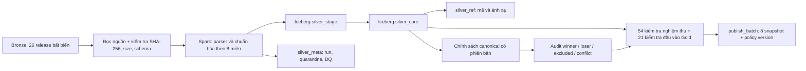

# Tổng kết xây dựng tầng Silver V2

**Dự án:** Agricultural Export Data Lakehouse
**Phạm vi:** từ 26 bản phát hành Bronze đến đầu vào phân tích cho Gold
**Trạng thái kiểm tra:** 22/10/2026
**Batch đang hoạt động:** `silver-v2-recovered-20261022` — `ACTIVE_WITH_EXCEPTIONS`

Tài liệu này ghi lại công việc đã thực hiện, cấu trúc được xây dựng, kết quả chạy trên dữ liệu thật và những điều kiện còn phải giải quyết. [Thiết kế Gold](GOLD_V2_CONTRACT.md) và [kế hoạch chuyển đổi Silver](SILVER_V2_IMPLEMENTATION_CONTRACT.md) là tài liệu yêu cầu; [runbook](V2_RUNBOOK.md) là hướng dẫn vận hành.

## 1. Mục tiêu và phạm vi hoàn thành

Silver V2 nhận các object Bronze bất biến, kiểm tra danh tính nguồn và tính toàn vẹn tệp, chuyển từng dòng nguồn thành quan sát ở đúng grain, lưu dữ liệu nguyên tử trong Iceberg, quản lý tham chiếu và lineage, ghi kết quả chất lượng, sau đó chọn bản ghi chuẩn bằng chính sách có phiên bản. Silver không tự tổng hợp nhiều nguồn thành KPI của Gold.

Đã thực hiện:

1. Nạp 26 bản phát hành Bronze vào 8 miền `silver_stage` và `silver_core`.
2. Tạo các namespace metadata và reference để quản lý nguồn, kỳ, mã, đơn vị, chính sách, audit, conflict và batch phát hành.
3. Xây dựng chính sách canonical theo nguồn và bản phát hành; không tự chọn giá trị khi dữ liệu nguồn mâu thuẫn.
4. Kiểm tra chất lượng, đối soát stage/core, chạy thử đầu vào của 8 Fact Gold và demo Airflow.
5. Kích hoạt V2, xóa mã chạy, DAG, 9 bảng và namespace V1 khỏi hệ thống đang hoạt động. Sau sự cố xóa object MinIO ngày 22/10/2026, dựng lại V2 từ Bronze còn nguyên và bật versioning cho bucket `warehouse`.
6. Dọn mã demo, cấu hình và log không còn được sử dụng, cập nhật tài liệu vận hành.

**Ranh giới bàn giao:** Gold hiện là hợp đồng thiết kế gồm 8 Fact và 8 Dimension. Chưa có mô hình Gold được xây dựng hay triển khai. Các bài smoke test xác nhận đầu vào Silver cho Gold, không phải nghiệm thu kho Gold hoàn chỉnh.

## 2. Kiến trúc và vị trí lưu trữ



MinIO có bucket `bronze` cho dữ liệu đầu vào và bucket `warehouse` cho toàn bộ bảng Iceberg. **Không có bucket Silver riêng.** Trong giao diện MinIO, mở `warehouse` sẽ thấy:

```text
warehouse/
  silver_stage/    8 bảng trung gian đã chuẩn hóa
  silver_core/     8 bảng quan sát nguyên tử để bàn giao
  silver_meta/     metadata, DQ, canonical và batch
  silver_ref/      danh mục mã và tham chiếu
```

Iceberg REST Catalog quản lý namespace và snapshot; Spark ghi và kiểm tra dữ liệu; Trino dùng để truy vấn; Airflow điều phối DAG `silver_v2_backfill`. Bucket sao lưu V1 trước đây cũng bị xóa object và không còn là nguồn khôi phục. Hiện `warehouse` đã bật versioning.

## 3. Nguồn Bronze và quy tắc đọc

26 tệp nguồn thuộc FAOSTAT Production, Producer Prices, Trade Matrix và TCL; UN Comtrade; World Bank Pink Sheet và WDI; NASA POWER; cùng sáu nguồn nông nghiệp cấp tỉnh. Có 21 CSV và 5 XLSX. Danh sách `dataset_id`, số dòng và `observation_set_id` của từng bản phát hành nằm ở [bảng đối soát](../../reports/silver_v2_dataset_reconciliation.csv).

Luồng đọc chỉ chấp nhận metadata `latest_success` có trạng thái `SUCCESS`, `dataset_id`, định dạng và hệ nguồn đúng với registry. Tệp được tải theo luồng, kiểm tra kích thước và SHA-256 so với Bronze trước khi parse. Header CSV/XLSX phải khớp định nghĩa đã duyệt; thay đổi cấu trúc nguồn khiến job lỗi để được xem xét. XLSX được đọc ở chế độ read-only và chuyển thành dữ liệu đầu vào cho Spark. Mỗi dòng giữ locator của tệp hoặc sheet và số dòng, bản ghi JSON gốc và hash nội dung.

Danh tính kỹ thuật:

- `observation_set_id` = hash của `dataset_id`, định danh bản phát hành và SHA-256 tệp.
- `observation_id` = hash của `dataset_id`, observation set, locator dòng nguồn và metric.
- Mọi quan sát giữ `bronze_path`, `source_file`, `source_record_hash`, `ingestion_run_id` và thời điểm xử lý để truy ngược về Bronze.
- Chạy lại cùng bản phát hành sẽ bỏ qua dữ liệu đã có; bản sửa đổi nguồn phải được Bronze công bố thành release mới.

## 4. Tám bảng Silver Core

Một dòng ở các bảng này là **một quan sát/measure nguyên tử**, chưa phải dòng Fact đã pivot và chưa được phép cộng tùy ý giữa các nguồn.

| Bảng `silver_core` | Nguồn và cách xử lý chính | Số dòng core/stage | Winner canonical |
| --- | --- | ---: | ---: |
| `production_observation` | FAOSTAT Production; giữ Country, Item, Year, Element, cờ nguồn và giá trị thiếu. | 28.409 | 26.578 |
| `provincial_agri_observation` | Dữ liệu tỉnh/huyện; giữ cấp địa lý, coverage, status, tên nguồn và phiên bản địa lý. | 3.298 | 3.055 |
| `price_observation` | FAOSTAT Producer Prices, Pink Sheet, giá cà phê địa phương; phân biệt giá tiền và chỉ số, đơn vị, tiền tệ, chuỗi giá. | 16.207 | 15.709 |
| `trade_total_observation` | FAOSTAT TCL và xuất khẩu cà phê cấp tỉnh; giữ flow, product, classification, metric và phạm vi thống kê. | 44.751 | 44.367 |
| `trade_partner_observation` | FAOSTAT Trade Matrix và Comtrade; giữ reporter, partner, partner2, customs, transport, HS version và các measure gốc. | 27.182 | 5.920 |
| `weather_daily` | NASA POWER theo điểm và ngày; giữ từng biến đo, cờ hợp lệ và vị trí nguồn. | 614.754 | 614.628 |
| `coffee_stock_observation` | Tồn kho cà phê theo niên vụ và scenario; giữ nghìn bao, 60 kg/bao và tấn. | 450 | 450 |
| `macro_indicator_observation` | WDI theo chỉ tiêu và năm; giữ unit, scale, quy tắc tổng hợp và NULL nguồn. | 396 | 258 |
| **Tổng** | **8 bảng nguyên tử** | **735.447** | **710.965** |

Số winner là kết quả của chính sách hiện hành, không phải số dòng nguồn bị xóa. Dòng không được chọn vẫn ở `silver_core` và có quyết định audit.

### Các xử lý nghiệp vụ quan trọng

- **Địa lý tỉnh/huyện:** 2.142 quan sát cấp huyện không có mã hành chính chính thức trong nguồn. V2 tạo khóa ổn định `SRC_DISTRICT_...` theo dataset, phiên bản địa lý, tỉnh và tên huyện; mã huyện chính thức vẫn NULL. Có 44 alias ở trạng thái `PENDING`. Cấp huyện không bị gộp vào cấp tỉnh. Các dòng `district total` và `province total` được gắn coverage `ALL_PRODUCERS`; scope khác được giữ đúng ý nghĩa nguồn.
- **Giá:** 800 dòng Monthly Prices của Pink Sheet được trải thành 3.200 quan sát theo bốn chuỗi. 1.163 dòng tiêu đề, mô tả hoặc sheet không phải quan sát được loại khỏi Fact nhưng vẫn được hạch toán. Giá trị tiền và price index không được đặt cùng measure; giá LCU/SLC không được quy đổi bằng tỷ giá WDI khác kỳ.
- **Giao dịch:** 2.807 dòng Comtrade annual và 7.824 dòng monthly được bảo toàn thành 21.262 quan sát nguyên tử; giữ các biến thể và các cột CIF/FOB/primary. Chính sách canonical Comtrade đang tắt vì quy tắc phân loại, phạm vi và định giá chưa được phê duyệt. FAOSTAT Trade Matrix có 5.920 winner theo nguồn của nó.
- **Thời tiết:** sentinel `-999` thành NULL ở cột đo, có cờ hợp lệ cho từng biến và số lượng measure hợp lệ. Giá trị solar gốc được giữ; `solar_radiation_mj_m2_day` để NULL vì Bronze không ghi đủ ngữ cảnh API/đơn vị để xác nhận phép đổi.
- **Tồn kho:** giữ riêng `ACTUAL` và `FORECAST`, chuẩn hóa tấn = nghìn bao × 60 kg. Không cộng hai scenario như một chuỗi thực tế.
- **WDI:** giữ nguyên 138 giá trị NULL từ nguồn; metadata indicator quản lý đơn vị và phép tổng hợp. NULL hợp lệ không bị điền số giả.
- **Mã FAO tổng hợp:** mã nguồn FAO 159 vẫn được bảo tồn, nhưng không dùng làm khóa M49 canonical khi không phải mã quốc gia M49 hợp lệ.

## 5. Metadata, reference và kiểm soát chất lượng

`silver_meta` gồm `dataset_registry`, `observation_set`, `ingestion_run`, `source_selection_policy`, `canonical_decision`, `canonical_conflict`, `dq_result`, `quarantine_record` và `publish_batch`. Chúng cho biết tệp nào được nạp, release nào đang công bố, job đã làm gì, luật nào chọn winner, dòng nào bị loại, xung đột nào đang mở và batch nào đang hoạt động.

`silver_ref` gồm các danh mục country, commodity, geography, geography_alias, weather_location, trade_product, bridge trade product/commodity, unit_conversion, metric_definition, price_series, macro_indicator và period. Các ánh xạ chưa đủ căn cứ được ghi `PENDING`, không được tự gán thành `APPROVED`.

Chính sách hiện hành `source-local-v5-3cb854afd9b7f156` định danh theo tập observation set đã công bố. Khóa canonical bao gồm dataset và grain nghiệp vụ, nên không so sánh hay cộng các nguồn khác nhau. Trong một nguồn, chọn release đủ điều kiện mới nhất theo status/thời điểm; quan sát có cùng grain và cùng giá trị lấy một winner ổn định; các giá trị khác nhau trong release được ghi conflict và **không có winner**. Audit ghi `WINNER`, `LOSER` hoặc `EXCLUDED` cho từng quan sát.

Sáu nhóm giá Đắk Lắk năm 2022 có 12 dòng mâu thuẫn vẫn nằm trong core; cả sáu nhóm có conflict `OPEN/BLOCK` và không có winner. Không áp dụng quy tắc “lấy giá lớn nhất” của V1.

Đối với dòng lỗi parse, job ghi `quarantine_record` kèm locator và payload nguồn, ghi DQ thất bại và chặn công bố release. Kiểm tra sau nạp gồm đối soát số dòng, `observation_id` duy nhất, lineage đầy đủ, FK observation set, parity stage/core, audit coverage, mã tham chiếu, unit và ràng buộc riêng của từng miền.

## 6. Điều phối, phát hành và chuyển khỏi V1

DAG Airflow `silver_v2_backfill` nhận một hoặc nhiều `dataset_id`, gọi runner nội bộ bằng token, chạy Spark submit và kiểm tra kết quả. Runner chỉ chấp nhận pipeline V2, giới hạn một job tại một thời điểm và hỗ trợ retry theo run ID. Job nguồn tạo stage/core, metadata và kết quả run; sau đó các job reference, policy, canonical và validate hoàn thiện release.

Quy trình phát hành dùng `silver_v2_prepare_publish.py` để lưu 8 snapshot ID, row count, DQ run và policy version. `silver_v2_activate.py` kiểm tra lại 54 kết quả DQ, đúng hai loại WARN đã biết, snapshot/row count chưa đổi và chính sách còn hiện hành trước khi đặt batch thành `ACTIVE_WITH_EXCEPTIONS`. `publish_batch` là con trỏ release. Đọc một release ổn định cần dùng các snapshot ID của batch; Iceberg không có giao dịch chung cho tám bảng.

Khi V2 đạt gate, DAG V1 `silver_transformation`, runner V1, mã transform cũ, bảng và namespace `iceberg.silver` đã bị xóa. Các file dbt/ML demo không còn hoạt động cùng log thử nghiệm cũ đã được dọn. Trạng thái hiện tại chỉ còn namespace `silver_core`, `silver_stage`, `silver_meta`, `silver_ref` và namespace hệ thống trong catalog. Sau khi các object MinIO bị xóa ngày 22/10/2026, V2 được dựng lại từ Bronze; bản sao lưu V1 cũng mất và không còn được dùng để phục hồi. Catalog cũ được giữ riêng để điều tra, catalog mới đang phục vụ truy vấn.

## 7. Kiểm thử và bằng chứng demo

| Hạng mục | Kết quả đã ghi nhận |
| --- | --- |
| Đối soát nguồn | 26 observation set `PUBLISHED`; chạy lại 26 release không sinh dòng trùng. |
| Nghiệm thu Silver | Run `acceptance-v2-recovery-20261022`: 54 check, 52 PASS, 2 WARN, 0 BLOCK failure. |
| Hai WARN | 6 nhóm giá conflict; 2.142 dòng huyện chờ mã hành chính chính thức. |
| Đầu vào Gold | 21/21 smoke check đạt trên 8 miền và các reference liên quan. |
| Parser nguồn thật | 11 mẫu adapter từ FAOSTAT, tỉnh, Pink Sheet, Comtrade, NASA, WDI đạt. |
| DAG demo | Sau khôi phục, `silver_v2_backfill` chạy WDI lúc 13:34 UTC và chạy cả 26 nguồn không truyền cấu hình lúc 13:36 UTC; cả hai kết thúc `success`. |
| Unit test | 33 bài chạy đạt; 1 bài bỏ qua do thiếu dependency tùy chọn trên host. |
| Cấu hình và mã | `docker compose config --quiet`, `git diff --check`, phân tích cú pháp Python đạt; Airflow không có DAG import error. |
| Catalog sau cắt chuyển | Namespace V1 không còn; batch V2 còn `ACTIVE_WITH_EXCEPTIONS`. |

Truy vấn kiểm tra nhanh:

```bash
docker compose exec -T trino trino --execute 'SHOW SCHEMAS FROM iceberg'
docker compose exec -T trino trino --execute 'SHOW TABLES FROM iceberg.silver_core'
docker compose exec -T trino trino --execute "SELECT batch_id,status,policy_version FROM iceberg.silver_meta.publish_batch WHERE status LIKE 'ACTIVE%'"
docker compose exec -T trino trino --execute "SELECT status,count(*) FROM iceberg.silver_meta.dq_result WHERE run_id='acceptance-v2-recovery-20261022' GROUP BY status"
docker compose exec -T airflow-apiserver airflow dags list-runs silver_v2_backfill -o json
```

Các lệnh chạy lại toàn bộ chuỗi và cách khôi phục catalog nằm trong [runbook](V2_RUNBOOK.md).

## 8. Giới hạn và việc tiếp theo

**Silver V2 đã được kích hoạt và có thể phục vụ tầng Gold theo đúng ngoại lệ đã công bố.** Các giá trị chưa được nguồn chứng minh không được suy đoán:

1. Cần dữ liệu hoặc quyết định nghiệp vụ để giải quyết sáu nhóm giá mâu thuẫn.
2. Cần bảng mã hành chính có phiên bản để phê duyệt 44 alias huyện và thay khóa nguồn bằng mã chính thức khi có căn cứ.
3. Cần request/metadata NASA gốc để xác minh đơn vị solar trước khi tính MJ/m²/ngày.
4. Cần chính sách sản phẩm, partner, customs/transport, quantity và valuation để bật canonical Comtrade.
5. Cần xây dựng và nghiệm thu thực tế 8 Fact, 8 Dimension cùng semantic layer Gold theo hợp đồng riêng.

Hệ thống Compose hiện chỉ mở các cổng trên localhost, nhưng `.env` vẫn dùng credential phát triển và Iceberg REST fixture dùng SQLite một nút. Trước khi triển khai ra môi trường production dùng chung, cần thay credential, catalog bền vững và cơ chế backup/khôi phục tương ứng. Trạng thái `ACTIVE_WITH_EXCEPTIONS` là trạng thái phát hành **tầng Silver trên bộ dữ liệu hiện có**, không phải tuyên bố rằng toàn bộ nền tảng và Gold đã production-ready.

## 9. Bản đồ mã nguồn

| Vị trí | Vai trò |
| --- | --- |
| [`spark/silver_v2/registry.py`](../../spark/silver_v2/registry.py), [`config/`](../../spark/silver_v2/config/) | 26 định nghĩa nguồn, header, quy tắc và địa lý. |
| [`readers.py`](../../spark/silver_v2/readers.py), [`identity.py`](../../spark/silver_v2/identity.py) | Đọc Bronze có xác minh; ID ổn định và lineage. |
| [`domains.py`](../../spark/silver_v2/domains.py), [`parsers/`](../../spark/silver_v2/parsers/) | Schema và chuyển đổi tám miền dữ liệu. |
| [`pipeline.py`](../../spark/silver_v2/pipeline.py), [`foundation.py`](../../spark/silver_v2/foundation.py) | Nạp stage/core, hạch toán dòng, metadata và quarantine. |
| [`policy.py`](../../spark/silver_v2/policy.py), [`canonical.py`](../../spark/silver_v2/canonical.py) | Chính sách chọn nguồn và audit winner/conflict. |
| [`spark/jobs/`](../../spark/jobs/) | Job backfill, reference, validate, smoke, prepare và activate. |
| [`airflow/dags/silver_v2_backfill.py`](../../airflow/dags/silver_v2_backfill.py) | Điều phối thủ công qua Airflow. |
| [`reports/silver_v2_reconciliation.md`](../../reports/silver_v2_reconciliation.md) | Tóm tắt số liệu phát hành và bằng chứng kiểm tra. |
